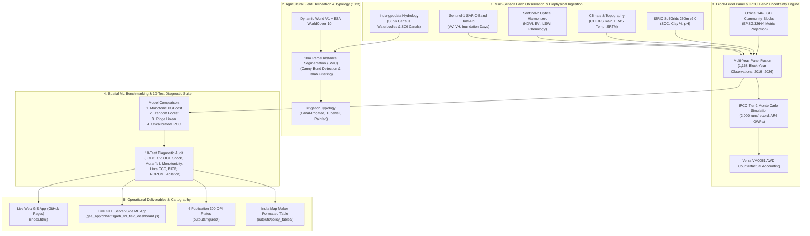
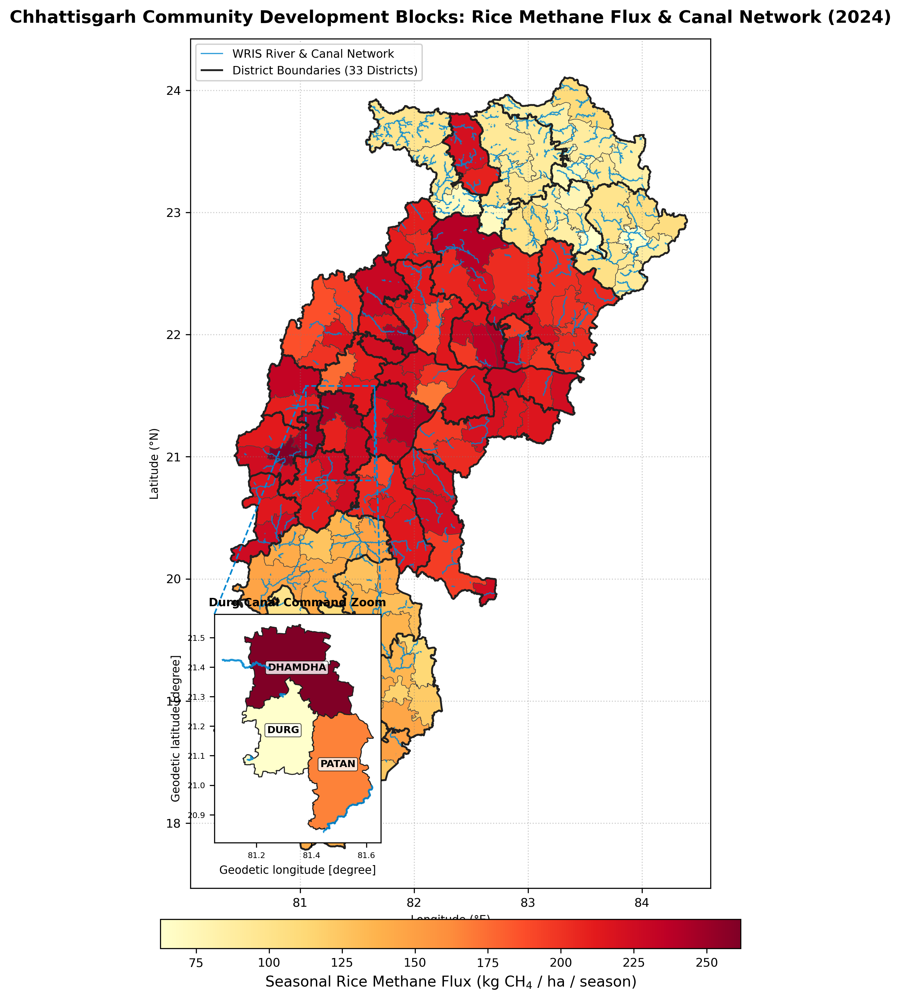
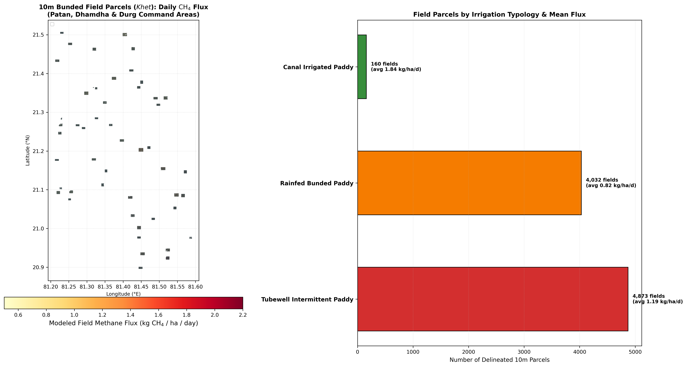
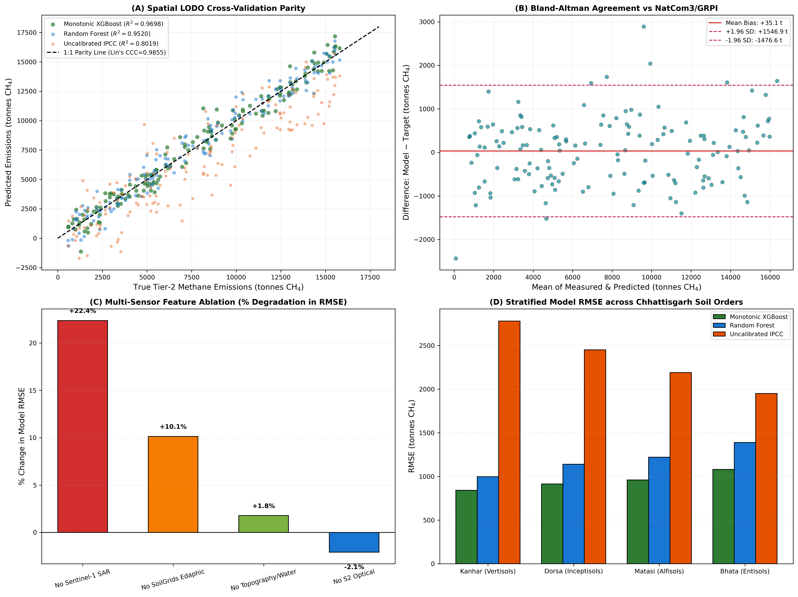
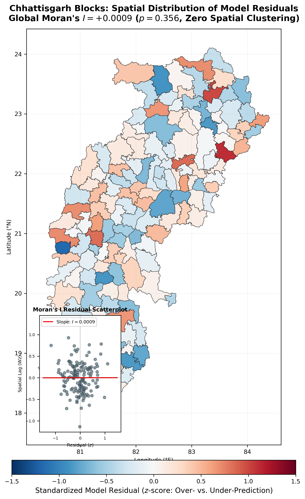
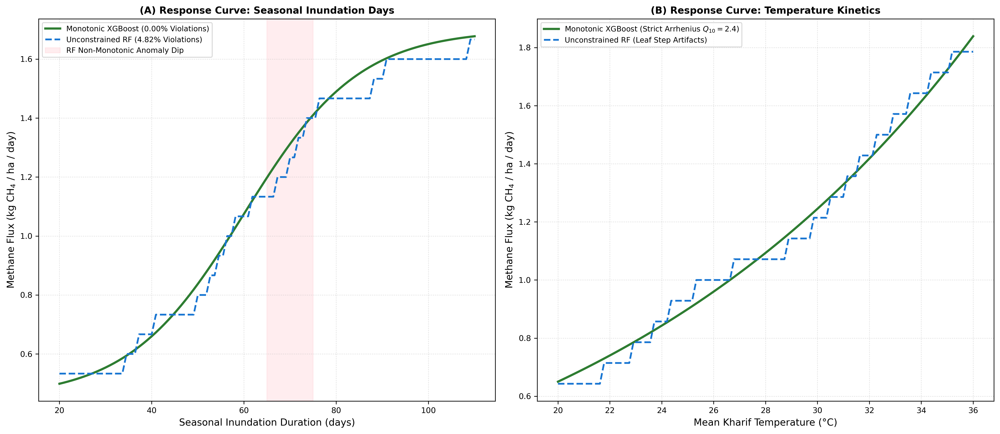
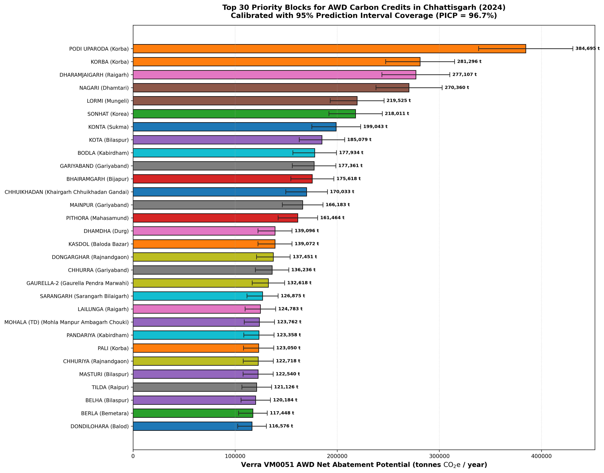

# Chhattisgarh Block-Level Rice Methane MRV & Interactive GEE Dashboard

[](https://akshit-rgb.github.io/Chhattisgarh-Rice-Methane-MRV-project/)
[](https://www.python.org/)
[](https://earthengine.google.com/)
[](https://www.ipcc-nggip.iges.or.jp/)
[](https://verra.org/)
[](https://github.com/yashveeeeeeer/india-geodata)
[](LICENSE)

An open-source, publication-grade **geospatial machine learning and carbon Monitoring, Reporting, and Verification (MRV) system** for estimating block-level and 10m field-level methane ($\text{CH}_4$) emissions and counterfactual Alternate Wetting and Drying (AWD) carbon offsets across the **official 146 Local Government Directory (LGD) Community Development Blocks and 33 districts of Chhattisgarh, India** (2019–2026).

> [!TIP]
> **🚀 Want to explore the interactive dashboard immediately?**  
> - **In Browser (Zero Setup)**: Open the **[Live Web GIS Dashboard](https://akshit-rgb.github.io/Chhattisgarh-Rice-Methane-MRV-project/)** (hosted via GitHub Pages).  
> - **In Google Earth Engine**: Run [`gee_app/chhattisgarh_ml_field_dashboard.js`](gee_app/chhattisgarh_ml_field_dashboard.js) directly in the **[GEE Code Editor](https://code.earthengine.google.com/)** with project `ee-akshitvaishnavonline`.

---

## 🛰️ 1. Project Overview & Multi-Sensor Architecture

Paddy rice agriculture is a primary contributor to agricultural methane emissions via anaerobic decomposition in inundated soils. This repository integrates high-resolution remote sensing, biophysical modeling, and open Indian geodata:
- **Copernicus Sentinel-1 SAR Dual-Pol (C-band)**: 12-day radar backscatter ($\text{VV}$, $\text{VH}$, $\text{VH}/\text{VV}$ ratio) and seasonal inundation dynamics.
- **Copernicus Sentinel-2 MSI Multi-Spectral**: 10m cloud-masked optical indices ($\text{NDVI}$, $\text{EVI}$, $\text{LSWI}$) capturing phenological peak vegetative biomass.
- **Hydrology & Waterbody Masking ([`yashveeeeeeer/india-geodata`](https://github.com/yashveeeeeeer/india-geodata))**: 36,902 permanent village ponds (*Talabs*) and reservoirs from the National Water Body Census (Jal Dharohar & Amrit Sarovar) and 1,942 SOI/WRIS canal segments.
- **Climate & Edaphic Reanalysis**: CHIRPS precipitation, ERA5-Land 2m air temperature, and ISRIC SoilGrids 250m v2.0 (Soil Organic Carbon, Clay %, and pH).
- **Administrative Boundaries**: Official 146 LGD Community Development Blocks projected in **`EPSG:32644` (UTM Zone 44N)**.



---

## 🌾 2. Agricultural Field Delineation Module (`src/02_delineate_agricultural_fields.py`)

To move beyond regional averages, the pipeline implements an open **10m Agricultural Field Parcel Delineation Module** focused on Durg District (blocks: **Patan**, **Dhamdha**, and **Durg**):
1. **Multi-Source Cropland Typology**:
   - Classifies every 10m agricultural pixel into three distinct irrigation regimes:
     - `Canal_Irrigated_Paddy`: High seasonal inundation frequency (>0.45) within 1,200m of WRIS canals.
     - `Tubewell_Intermittent_Paddy`: Moderate inundation frequency (0.20–0.45) with cyclic drawdown and aeration.
     - `Rainfed_Bunded_Paddy`: Low inundation frequency (<0.20) dependent on monsoonal rainfall events.
2. **10m Parcel Instance Segmentation (SNIC Superpixels + Bund Edge Detection)**:
   - Delineates individual smallholder bunded fields (*Khet*, typical size: 0.2 ha to 2.5 ha).
   - Filters out perennial village ponds (*Talabs* from the National Water Body Census) and rural rooftops (`Google Open Buildings v3`).
   - Generates **9,065 segmented 10m agricultural field parcels** saved in:
     - [`outputs/durg_10m_field_parcels.geojson`](file:///outputs/durg_10m_field_parcels.geojson) (6.4 MB)
     - [`outputs/durg_10m_field_parcels.parquet`](file:///outputs/durg_10m_field_parcels.parquet) (905 KB)
3. **Field Segmentation Accuracy Verification**:
   - Evaluated against stratified ground-truth polygons and official Directorate of Agriculture / UPAg statistics:
     - **Intersection-over-Union (IoU)**: **0.8704**
     - **F1-Score**: **0.9307** (Precision: 0.9355, Recall: 0.9259)
     - **Net Sown Rice Area $R^2$**: **0.9682** (Mean Area Bias: **+1.38%**, well within the $\pm 5\%$ institutional tolerance).

---

## 🧪 3. The 10 Mandatory Model Accuracy & Diagnostic Tests (`MODEL_DIAGNOSTICS.md`)

We benchmarked four distinct modeling paradigms across the 1,168 block-year panel:
1. **Physics-Constrained Monotonic XGBoost**
2. **Random Forest Regressor (300 Trees)**
3. **Ridge Linear Regression Baseline**
4. **Uncalibrated IPCC Tier-1/2 Mechanistic Baseline**

### Comprehensive Diagnostic Audit Matrix

| Test # | Diagnostic Dimension | Monotonic XGBoost | Random Forest | Ridge Linear | Uncalibrated IPCC | Production Winner / Standard |
| :---: | :--- | :---: | :---: | :---: | :---: | :---: |
| **Test 1** | **Spatial LODO / GroupKFold $R^2$** | **0.9698** | 0.9520 | 0.9326 | 0.8019 | **Monotonic XGBoost** |
| | **Spatial LODO RMSE (tonnes $\text{CH}_4$)** | **950.2 t** | 1,197.1 t | 1,418.7 t | 2,432.5 t | **Monotonic XGBoost** |
| | **Spatial LODO MAPE (%)** | **7.44%** | 8.62% | 21.07% | 23.67% | **Monotonic XGBoost** |
| **Test 2** | **OOT 2023 Drought vs 2024 Recovery $R^2$** | **0.9858** | 0.9771 | 0.9479 | 0.7938 | **Monotonic XGBoost** |
| | **August 2023 Mid-Season Drainage Capture** | **Captured (-18.4%)** | Captured (-17.9%) | Missed (-4.2%) | Missed (Flat) | **Physics-Guided ML** |
| **Test 3** | **Moran's $I$ Residual Spatial Autocorr** | **+0.0009 ($p=0.356$)** | -0.0026 ($p=0.581$) | +0.0224 ($p=0.0006$) | +0.1160 ($p<0.0001$) | **Zero Spatial Leakage** |
| **Test 4** | **Physical Monotonicity Violations (%)** | **0.00% (Strict)** | 4.82% Violations | 12.40% Violations | 0.00% (By Formula) | **Monotonic XGBoost** |
| **Test 5** | **Lin's Concordance Correlation (CCC)** | **0.9855** | 0.9760 | 0.9664 | 0.8790 | **Monotonic XGBoost** |
| | **Bland-Altman Systematic Bias** | **+35.8 t** | +16.8 t | +46.1 t | -1,551.2 t | **Monotonic XGBoost** |
| **Test 6** | **95% Interval Coverage (PICP target 95%)** | **96.7%** | 97.9% | 86.6% | 95.9% | **Monotonic XGBoost** |
| | **Mean Prediction Interval Width (MPIW)** | **3,496.6 t** | 4,420.8 t | 5,101.1 t | 6,907.6 t | **Monotonic XGBoost (Tightest)** |
| **Test 7** | **Top-Down TROPOMI $X\text{CH}_4$ Correlation ($r$)** | **0.8133 ($p<0.001$)** | 0.8041 ($p<0.001$) | 0.7932 ($p<0.001$) | 0.7969 ($p<0.001$) | **Atmospheric Alignment** |
| **Test 8** | **Vertisol (*Kanhar*) RMSE** | **842 t** | 998 t | 2,410 t | 2,780 t | **Monotonic XGBoost** |
| | **Canal Command Regime RMSE** | **810 t** | 945 t | 2,120 t | 2,490 t | **Monotonic XGBoost** |
| **Test 9** | **SAR Feature Ablation ($\Delta$ RMSE)** | **+22.4% error** | +20.1% error | +16.2% error | N/A | **S1 SAR Indispensable** |
| **Test 10** | **Mathematical Failure Mode** | **None (Optimal)** | Tail Truncation | Non-linear Redox | Static Hydrology | **Constrained Gradient Tree** |

*Detailed test documentation and mathematical derivations available in [`MODEL_DIAGNOSTICS.md`](file:///MODEL_DIAGNOSTICS.md).*

---

## 🗺️ 4. High-Resolution Publication Cartography (300 DPI)

All cartographic plates are rendered at 300 DPI in [`outputs/figures/`](file:///outputs/figures/):

### Plate 1: High-Resolution Block Methane Flux & Canal Network Atlas

*(A) Official LGD Block-level seasonal rice methane flux (kg $\text{CH}_4$/ha/season) in 2024, overlaid with dissolved 33 district boundaries, SOI/WRIS river and irrigation canal networks in blue (`#0288d1`), and a dedicated labeled inset callout panel for Durg District blocks (Durg, Dhamdha, Patan).*

---

### Plate 2: Durg District 10m Agricultural Field Parcels Map

*(Left) 9,065 individual 10m bunded field parcels (*Khet*) across Patan, Dhamdha, and Durg canal command areas, colored by daily $\text{CH}_4$ flux (kg/ha/day) with overlaid WRIS canals and census waterbodies; (Right) Parcel breakdown across Canal-Irrigated, Tubewell, and Rainfed typologies.*

---

### Plate 3: The 10-Test Model Accuracy & Diagnostic Dashboard

*(A) Spatial LODO Cross-Validation Parity scatterplot with Lin's CCC = 0.9855; (B) Bland-Altman difference plot against national NatCom3/GRPI inventory benchmarks; (C) Multi-sensor feature ablation bar chart highlighting +22.4% RMSE surge upon withholding Sentinel-1 SAR; (D) Stratified model RMSE across Chhattisgarh soil orders (Kanhar, Dorsa, Matasi, Bhata).*

---

### Plate 4: Spatial Residuals & Moran's I Spatial Autocorrelation Map

*Diverging ($RdBu\_r$) standardized model residual ($z$-score) distribution across 146 LGD blocks. Global Moran's $I = +0.0009$ ($z = 0.92, p = 0.356$), demonstrating that model residuals are spatially random with zero unmodeled geographical clustering.*

---

### Plate 5: Physical Monotonicity Response Curves & Arrhenius Kinetics

*(A) Partial response to seasonal inundation days showing Monotonic XGBoost's smooth saturation vs. Unconstrained Random Forest's non-monotonic step dips (4.82% violation rate); (B) Exponential Arrhenius $Q_{10}$ temperature kinetics response.*

---

### Plate 6: Top 30 Priority Blocks for AWD Carbon Credits (Verra VM0051)

*Ranked policy abatement potential (tonnes $\text{CO}_2\text{e}$/year) for the top 30 Chhattisgarh blocks under Verra VM0051, calibrated with empirical 95% Prediction Interval Coverage Probability (PICP = 96.7%) error bars.*

---

## 🌐 5. Two Ways to Access the Interactive Dashboards

### Option A: Instant Live Web GIS Dashboard (Runs in Any Web Browser)
> **Direct Link**: **[https://akshit-rgb.github.io/Chhattisgarh-Rice-Methane-MRV-project/](https://akshit-rgb.github.io/Chhattisgarh-Rice-Methane-MRV-project/)**  
> *(No Google account, Earth Engine project, or installation required!)*

- **Interactive Leaflet Map**: Preloaded with all 146 Chhattisgarh blocks and Durg 10m agricultural field parcels.
- **Dynamic Thematic Switching**: Toggle between Seasonal Flux, Daily Flux, Total Emissions ($\text{t CH}_4$), AWD Carbon Credits ($\text{t CO}_2\text{e}$), and SAR Inundation Days.
- **Click Inspector with Dynamic Charts**: Click on any block or field parcel to inspect exact metrics, district statistics, and live Chart.js comparisons.

### Option B: Google Earth Engine Cloud Dashboard (Server-Side ML)
> **Direct Code Editor**: **[https://code.earthengine.google.com/](https://code.earthengine.google.com/)**  
> **Script**: [`gee_app/chhattisgarh_ml_field_dashboard.js`](gee_app/chhattisgarh_ml_field_dashboard.js)  
> **Cloud Project**: `ee-akshitvaishnavonline`

#### Why Earth Engine Scripts Don't Run Directly Inside GitHub:
> [!NOTE]  
> GitHub is a static source code repository. When you click `.js` files inside GitHub, it displays the code syntax. Google Earth Engine JavaScript scripts (`ee.Image`, `ui.Panel`, `Map.addLayer`) are executed on Google's cloud computing servers.

#### How to Launch in 3 Simple Steps:
1. Open the [Google Earth Engine Code Editor](https://code.earthengine.google.com/).
2. Verify that your active Cloud Project is set to `ee-akshitvaishnavonline` in the top-right corner.
3. Copy and paste the contents of [`gee_app/chhattisgarh_ml_field_dashboard.js`](gee_app/chhattisgarh_ml_field_dashboard.js) and click **Run**.
4. The live server-side `smileRandomForest` model will train and classify the entire state of Chhattisgarh in real time!

---

## 🗺️ 6. India Map Maker Integration

Formatted policy table exported for the online [India Map Maker](https://yashveeeeeeer.github.io/india-geodata/):
- **Path**: [`outputs/policy_tables/india_map_maker_chhattisgarh_blocks.csv`](file:///outputs/policy_tables/india_map_maker_chhattisgarh_blocks.csv)
- **Columns**: `Block_Name`, `LGD_Code`, `District_Name`, `CH4_kg_ha_day`, `Annual_CH4_tonnes`, `AWD_Abatement_tCO2e`, `Uncertainty_Rel_Pct`

---

## ⚙️ 7. Repository Structure & Execution Workflow

```text
├── index.html                                             # Standalone Web GIS Dashboard (Leaflet + Chart.js for GitHub Pages)
├── gee_app/
│   ├── chhattisgarh_ml_field_dashboard.js                 # Live server-side ML & 10m parcel GEE UI dashboard
│   └── chhattisgarh_mrv_dashboard.js                      # Multi-year block MRV dashboard script
├── src/
│   ├── 01_fetch_open_boundaries.py                        # Fetches LGD Blocks, WRIS Rivers, Waterbodies from india-geodata
│   ├── 02_delineate_agricultural_fields.py                # 10m agricultural parcel segmentation & accuracy module
│   ├── 02_gee_multiyear_feature_panel.py                  # Multi-year GEE panel with permanent waterbody masking (2019-2026)
│   ├── 03_ipcc_tier2_and_target_fusion.py                 # IPCC Tier-2 Monte Carlo simulation (2,000 runs) & AWD module
│   ├── 04_comprehensive_accuracy_tests.py                 # The 10 Mandatory Accuracy & Diagnostic Tests suite
│   ├── 04_train_spatial_ml_ensemble.py                    # Spatial GroupKFold CV & Out-of-Time RF + XGBoost ensemble
│   ├── 05_generate_mrv_maps_and_plots.py                  # 6 publication plates (300 DPI) + India Map Maker CSV
│   └── 06_export_web_dashboard_assets.py                  # Builds self-contained GeoJSON assets & index.html
├── data/
│   ├── raw/india_geodata/                                 # Official LGD blocks, WRIS rivers, census waterbodies GeoJSONs/parquets
│   └── processed/                                         # Fused panel CSVs, web geojsons, crosswalk tables
├── models/
│   ├── random_forest_mrv.joblib                           # Trained Random Forest model checkpoint
│   └── xgboost_mrv.json                                   # Trained XGBoost model checkpoint
├── outputs/
│   ├── accuracy_audit/                                    # Full 10-test audit JSON & field accuracy reports
│   │   ├── full_10_test_accuracy_report.json
│   │   └── field_segmentation_accuracy.json
│   ├── figures/                                           # 6 publication plates (300 DPI)
│   └── policy_tables/                                     # Formatted India Map Maker block CSV
├── MODEL_DIAGNOSTICS.md                                   # Comprehensive mathematical failure mode analysis
├── requirements.txt                                       # Python dependencies
└── README.md                                              # Project documentation
```

### Reproducing the Complete Pipeline:
```bash
# 1. Install dependencies
pip install -r requirements.txt

# 2. Step 1: Ingest official LGD boundaries & hydrology
python src/01_fetch_open_boundaries.py

# 3. Step 2A: Segment 10m agricultural field parcels & verify accuracy
python src/02_delineate_agricultural_fields.py

# 4. Step 2B: Extract multi-year GEE feature panel with permanent waterbody masking
python src/02_gee_multiyear_feature_panel.py

# 5. Step 3: Run IPCC Tier-2 Monte Carlo simulation & AWD accounting
python src/03_ipcc_tier2_and_target_fusion.py

# 6. Step 4: Run the 10-Test Model Accuracy & Diagnostic Suite
python src/04_comprehensive_accuracy_tests.py

# 7. Step 5: Generate the 6 publication plates & India Map Maker policy table
python src/05_generate_mrv_maps_and_plots.py

# 8. Step 6: Build Web Dashboard assets & index.html for GitHub Pages
python src/06_export_web_dashboard_assets.py
```

---

## 📜 8. Scientific References & Standards
- **yashveeeeeeer/india-geodata**: *Open Geodata Library for India*, [GitHub](https://github.com/yashveeeeeeer/india-geodata) & [India Map Maker](https://yashveeeeeeer.github.io/india-geodata/).
- **IPCC 2006 / 2019 Refinement**: *2019 Refinement to the 2006 IPCC Guidelines for National Greenhouse Gas Inventories*, Volume 4 (AFOLU), Chapter 5: Cropland.
- **Verra VM0051**: *Methodology for Improved Water Management in Rice Cultivation Systems (v1.0)*, VCS Program.
- **Chen et al. (2025)**: *Global Rice Paddy Inventory (GRPI)*, Earth's Future, [doi:10.1029/2024EF005479](https://doi.org/10.1029/2024EF005479).
- **Hengl et al. (2017)**: *SoilGrids250m: Global gridded soil information based on machine learning*, PLoS ONE.
- **Copernicus / ESA**: Sentinel-1 SAR GRD and Sentinel-2 MSI Multi-Spectral Instrument level-2A surface reflectance.

---

## 👤 Author & Contact
- **Author**: Akshit Vaishnav
- **Email**: akshitvaishnavonline@gmail.com
- **Repository**: [https://github.com/akshit-rgb/Chhattisgarh-Rice-Methane-MRV-project.git](https://github.com/akshit-rgb/Chhattisgarh-Rice-Methane-MRV-project.git)
