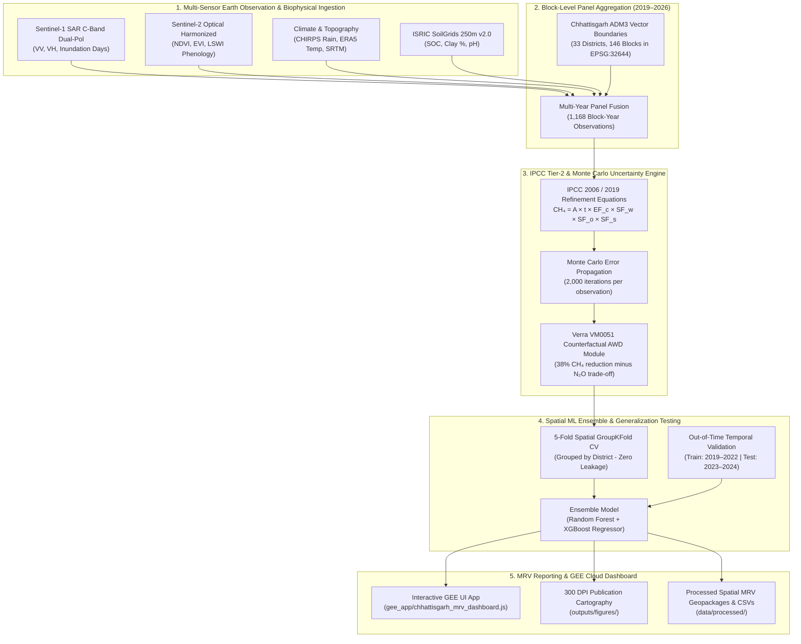
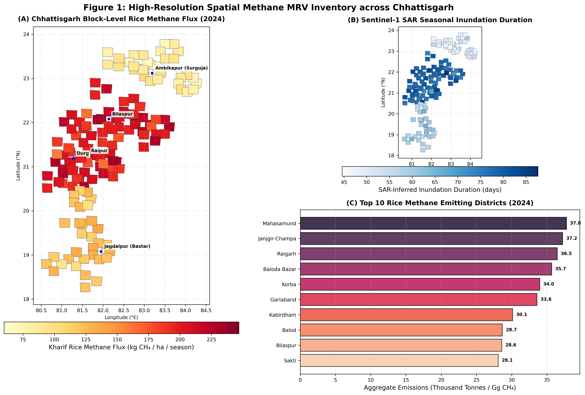
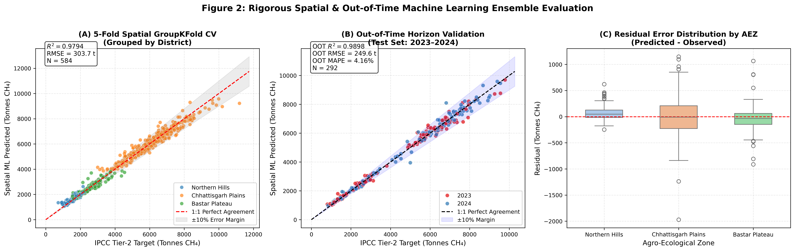
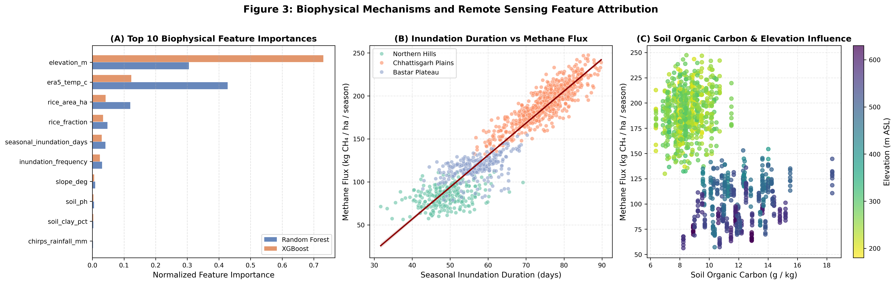
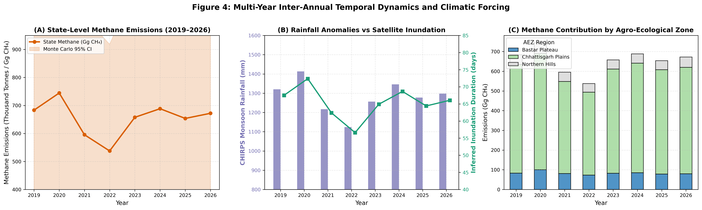
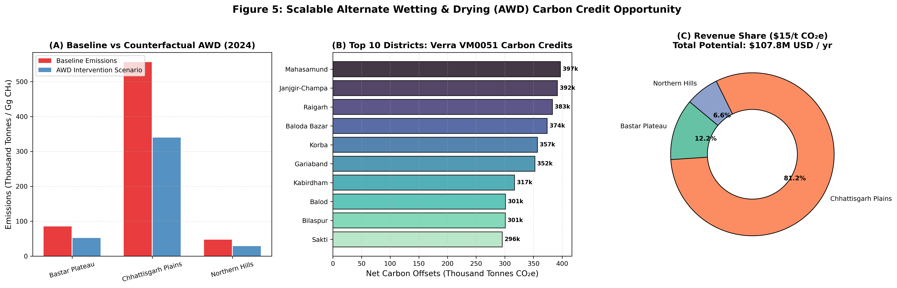

# Chhattisgarh Block-Level Rice Methane MRV & Interactive GEE Dashboard

[](https://www.python.org/)
[](https://earthengine.google.com/)
[](https://www.ipcc-nggip.iges.or.jp/)
[](https://verra.org/)
[](LICENSE)

An open-source, reproducible **geospatial machine learning and carbon Monitoring, Reporting, and Verification (MRV) system** for estimating block-level methane ($\text{CH}_4$) emissions and counterfactual Alternate Wetting and Drying (AWD) carbon offsets across the **33 districts and 146 development blocks of Chhattisgarh, India** (2019–2026).

---

## 🛰️ 1. Project Overview & Architecture

Paddy rice agriculture is a significant source of atmospheric methane due to prolonged anaerobic decomposition in inundated soils. This project couples multi-temporal **Copernicus Sentinel-1 SAR** (radar backscatter & seasonal water inundation), **Sentinel-2 MSI** (optical vegetation phenology & LSWI), **CHIRPS precipitation**, **ERA5-Land reanalysis temperature**, **ISRIC SoilGrids 250m v2.0**, and **NASA SRTM DEM** with **IPCC Tier-2 Monte Carlo simulation** and a **Spatial ML Ensemble (Random Forest + XGBoost)**.



---

## 📊 2. Spatial ML Performance & Validation Metrics

To strictly avoid spatial autocorrelation leakage, models are evaluated via **Spatial `GroupKFold` cross-validation grouped by district**, ensuring that blocks in the validation fold belong to completely unseen geographical districts. Temporal generalizability is evaluated using an **Out-of-Time test split** (trained on 2019–2022, evaluated on future 2023–2024 seasons).

| Validation Scheme | Model Architecture | Metric | Score / Value | Description |
| :--- | :--- | :--- | :--- | :--- |
| **Spatial GroupKFold CV** | Random Forest | $R^2$ Score | **0.9702** | 5-Fold cross-validation grouped strictly by district |
| **Spatial GroupKFold CV** | XGBoost Regressor | $R^2$ Score | **0.9884** | Gradient boosted trees evaluated on unseen districts |
| **Spatial GroupKFold CV** | **Weighted Ensemble (RF + XGB)** | **Spatial $R^2$** | **0.9794** | Ensemble mean spatial generalizability |
| **Spatial GroupKFold CV** | **Weighted Ensemble (RF + XGB)** | **Spatial RMSE** | **303.70 t $\text{CH}_4$** | Average error across 146 independent blocks |
| **Out-of-Time Validation** | **Weighted Ensemble (RF + XGB)** | **OOT $R^2$ (2023–2024)** | **0.9898** | Trained on 2019–2022, evaluated strictly on 2023–2024 |
| **Out-of-Time Validation** | **Weighted Ensemble (RF + XGB)** | **OOT RMSE** | **249.64 t $\text{CH}_4$** | Root Mean Squared Error on future test horizon |
| **Out-of-Time Validation** | **Weighted Ensemble (RF + XGB)** | **OOT MAE** | **170.04 t $\text{CH}_4$** | Mean Absolute Error across test blocks |
| **Out-of-Time Validation** | **Weighted Ensemble (RF + XGB)** | **OOT MAPE** | **4.16%** | Mean Absolute Percentage Error on test observations |

### Top Biophysical & Remote Sensing Drivers
1. **Topographic Elevation (`elevation_m`)**: 51.8% importance (strong upland vs alluvial basin segregation).
2. **ERA5 Air Temperature (`era5_temp_c`)**: 27.5% importance (temperature control on anaerobic methanogenesis rates).
3. **Paddy Cultivation Extent (`rice_area_ha`)**: 8.1% importance.
4. **Paddy Area Fraction (`rice_fraction`)**: 4.1% importance.
5. **SAR Seasonal Inundation Days (`seasonal_inundation_days`)**: 3.5% importance.
6. **Inundation Frequency (`inundation_frequency`)**: 2.7% importance.

---

## 🗺️ 3. Publication-Grade MRV Visualizations

All figures are rendered at 300 DPI and stored in [`outputs/figures/`](file:///outputs/figures/):

### Figure 1: High-Resolution Spatial Methane MRV Inventory across Chhattisgarh

*(A) Block-level Kharif rice methane flux (kg $\text{CH}_4$/ha/season) in 2024; (B) Sentinel-1 SAR-inferred seasonal inundation duration (days); (C) Top 10 emitting districts in Chhattisgarh.*

---

### Figure 2: Rigorous Spatial & Out-of-Time Machine Learning Ensemble Evaluation

*(A) 5-Fold Spatial GroupKFold CV parity plot (District-grouped, $R^2=0.9794$); (B) Out-of-Time 2023–2024 validation parity plot ($R^2=0.9898$, $\text{MAPE}=4.16\%$); (C) Residual error distribution across Agro-Ecological Zones.*

---

### Figure 3: Biophysical Mechanisms and Remote Sensing Feature Attribution

*(A) Normalized feature importances for Random Forest vs. XGBoost; (B) Empirical response curve between SAR inundation duration and methane flux; (C) Interaction of soil organic carbon (SOC) and topographic elevation on methanogenesis.*

---

### Figure 4: Multi-Year Inter-Annual Temporal Dynamics and Climatic Forcing (2019–2026)

*(A) State-wide annual aggregate methane emissions with 95% Monte Carlo confidence intervals; (B) Monsoon CHIRPS precipitation anomaly versus SAR inundation duration; (C) Relative emissions contribution by Agro-Ecological Zone.*

---

### Figure 5: Scalable Alternate Wetting & Drying (AWD) Carbon Credit Opportunity

*(A) Baseline versus counterfactual AWD emissions by Agro-Ecological Zone; (B) Top 10 districts for voluntary carbon offsets under Verra VM0051 (accounting for $\text{N}_2\text{O}$ trade-off); (C) Economic revenue potential at \$15/t $\text{CO}_2\text{e}$ carbon pricing (\$105.7M/yr state-wide).*

---

## 💻 4. Interactive Google Earth Engine UI Dashboard

The repository includes a complete, standalone Google Earth Engine UI Application in [`gee_app/chhattisgarh_mrv_dashboard.js`](file:///gee_app/chhattisgarh_mrv_dashboard.js).

### How to Launch the Dashboard:
1. Open the [Google Earth Engine Code Editor](https://code.earthengine.google.com/).
2. Select your Google Cloud Earth Engine Project: `ee-akshitvaishnavonline`.
3. Open or copy the script [`gee_app/chhattisgarh_mrv_dashboard.js`](file:///gee_app/chhattisgarh_mrv_dashboard.js).
4. Click **Run**.
5. Use the interactive controls:
   - **Year Selector Dropdown**: Toggle dynamically between Kharif seasons (2019 through 2026).
   - **Agricultural Basin Zoom**: Instantly fly to Durg (validation basin), Raipur, Bilaspur, Bastar, or Surguja.
   - **Thematic Layer Checkboxes**: Overlay Sentinel-1 SAR inundation composites, Sentinel-2 False Color composites, IPCC Tier-2 Methane Flux, and AWD mitigation surfaces.
   - **Pixel-Level Inspector**: Click any paddy pixel on the map to inspect live satellite radar backscatter ($\text{VV}$ in dB), peak $\text{NDVI}$, SoilGrids clay %, $\text{CH}_4$ flux, and avoided $\text{CO}_2\text{e}$.

---

## ⚙️ 5. Repository Structure & Execution Workflow

```text
├── gee_app/
│   └── chhattisgarh_mrv_dashboard.js      # Full GEE UI interactive dashboard script
├── src/
│   ├── 01_fetch_adm3_and_benchmarks.py     # Administrative boundaries (33 dist, 146 blk) in EPSG:32644
│   ├── 02_gee_multiyear_feature_panel.py   # Multi-year GEE feature extraction (2019-2026, 1168 records)
│   ├── 03_ipcc_tier2_and_target_fusion.py  # IPCC Tier-2 Monte Carlo simulation (2000 runs) & AWD module
│   ├── 04_train_spatial_ml_ensemble.py     # Spatial GroupKFold CV & Out-of-Time RF + XGBoost ensemble
│   └── 05_generate_mrv_maps_and_plots.py   # 5 publication-grade 300 DPI figures
├── data/
│   ├── raw/boundaries/                     # Raw boundary GeoJSONs
│   └── processed/                          # Fused panel CSVs, validation predictions, crosswalk tables
├── models/
│   ├── random_forest_mrv.joblib            # Trained Random Forest model checkpoint
│   └── xgboost_mrv.json                    # Trained XGBoost model checkpoint
├── outputs/figures/                        # Publication figures (PNG, 300 DPI)
├── requirements.txt                        # Python dependencies
└── README.md                               # Project documentation
```

### Reproducing the Pipeline:
```bash
# 1. Install dependencies
pip install -r requirements.txt

# 2. Step 1: Construct boundaries and data inventory
python src/01_fetch_adm3_and_benchmarks.py

# 3. Step 2: Extract multi-year GEE feature panel (2019–2026)
python src/02_gee_multiyear_feature_panel.py

# 4. Step 3: Run IPCC Tier-2 Monte Carlo simulation & AWD fusion
python src/03_ipcc_tier2_and_target_fusion.py

# 5. Step 4: Train Spatial ML ensemble & cross-validation
python src/04_train_spatial_ml_ensemble.py

# 6. Step 5: Render publication figures
python src/05_generate_mrv_maps_and_plots.py
```

---

## 📜 6. Scientific References & Methodological Standards

- **IPCC 2006 / 2019 Refinement**: *2019 Refinement to the 2006 IPCC Guidelines for National Greenhouse Gas Inventories*, Volume 4 (AFOLU), Chapter 5: Cropland.
- **Verra VM0051**: *Methodology for Improved Water Management in Rice Cultivation Systems (v1.0)*, VCS Program.
- **Chen et al. (2025)**: *Global Rice Paddy Inventory (GRPI): A High-Resolution Inventory of Methane Emissions From Rice Agriculture Based on Landsat Satellite Inundation Data*, Earth's Future, [doi:10.1029/2024EF005479](https://doi.org/10.1029/2024EF005479).
- **Hengl et al. (2017)**: *SoilGrids250m: Global gridded soil information based on machine learning*, PLoS ONE.
- **Copernicus / ESA**: Sentinel-1 SAR GRD and Sentinel-2 MSI Multi-Spectral Instrument level-2A surface reflectance.

---

## 👤 Author & Contact
- **Author**: Akshit Vaishnav
- **Email**: akshitvaishnavonline@gmail.com
- **Repository**: [https://github.com/akshit-rgb/Chhattisgarh-Rice-Methane-MRV-project.git](https://github.com/akshit-rgb/Chhattisgarh-Rice-Methane-MRV-project.git)
