# Statewide Chhattisgarh Rice Methane, Yield, Soil & Field Footprint MRV Pipeline
### *High-Resolution (146 Blocks & 14,405,396 Verified FTW Parcels across 33 Districts) Dual-Season MRV & CMIP6 Future Simulator (2019–2035)*

[](https://www.python.org/)
[](https://earthengine.google.com/)
[](https://qgis.org/)
[](https://www.ipcc.ch/)
[](https://verra.org/)
[-blueviolet.svg)](https://epsg.io/32644)
[](https://opensource.org/licenses/MIT)

---

## 📌 Executive Summary

This repository houses the **production-grade Measurement, Reporting, and Verification (MRV) pipeline** for paddy rice methane (CH4) emissions, coupled agronomic grain yields (t/ha), agro-ecological soil properties (Kanhar, Dorsa, Matasi, Bhata), and groundwater overdraft dynamics across all **146 administrative blocks** and **14,405,396 verified 10m agricultural field footprint parcels (1,448,309.2 ha)** in all **33 districts** of Chhattisgarh, India.

Spanning historical multi-satellite observation (**Kharif + Rabi 2019–2026**) and CMIP6 climate-coupled future forecasting (**2027–2035**), the pipeline integrates Sentinel-1 SAR inundation dynamics, Sentinel-2 Optical vegetation phenology, ISRIC SoilGrids 250m v2.0 edaphic attributes, WRIS/SOI irrigation canals, and real 2024 **Fields of the World (FTW)** instance segmentation tiles with empirical closed-chamber flux measurements (IARI New Delhi, IGKV Raipur, NRRI Cuttack).

---

## 🔬 Core Methodological Principles & Domain Constraints

1. **Strict Projected CRS Integrity**:
   - All spatial calculations, parcel area delineations, and cartographic projections strictly use **`EPSG:32644`** (WGS 84 / UTM Zone 44N). No unprojected `EPSG:4326` or distorted Web Mercator area evaluations.
2. **IPCC AR6 Global Warming Potentials**:
   - Global Warming Potentials: GWP_100(CH4) = 27.9, GWP_100(N2O) = 273.
3. **Metric & Conceptual Separation**:
   - Inundation duration (days), active rice area (ha), unit daily flux (kg CH4/ha/day), seasonal mass (Tonnes CH4), and carbon revenue (tCO2e) remain strictly separated.
4. **Real 2024 Fields of the World (FTW) Parcel Delineation**:
   - 14,405,396 real 10m agricultural field parcels extracted from 23 raw 1x1 degree GeoParquet tiles across all 33 districts, eliminating any blank map voids.
5. **Physical Monotonicity Enforcement**:
   - Constrained gradient-boosted trees enforce strictly non-negative flux scaling against inundation duration, topsoil organic carbon (SOC), clay content, and Arrhenius bacterial kinetics (Q10 = 2.2).
6. **Zero Data Fabrication**:
   - Real block boundaries, verified chamber benchmarks, and physical sensor retrievals only.

---

## 🗺️ Spatial Cartography Map Plates

### Plate 1: Statewide Kharif vs. Rabi Rice Methane Atlas (All 146 Blocks)
Two-panel high-resolution choropleth atlas comparing Season 1 (Kharif Monsoon) flood-fed methane flux with Season 2 (Rabi Summer *Garma Dhan*) tube-well pumping emissions across all 146 blocks in Chhattisgarh.
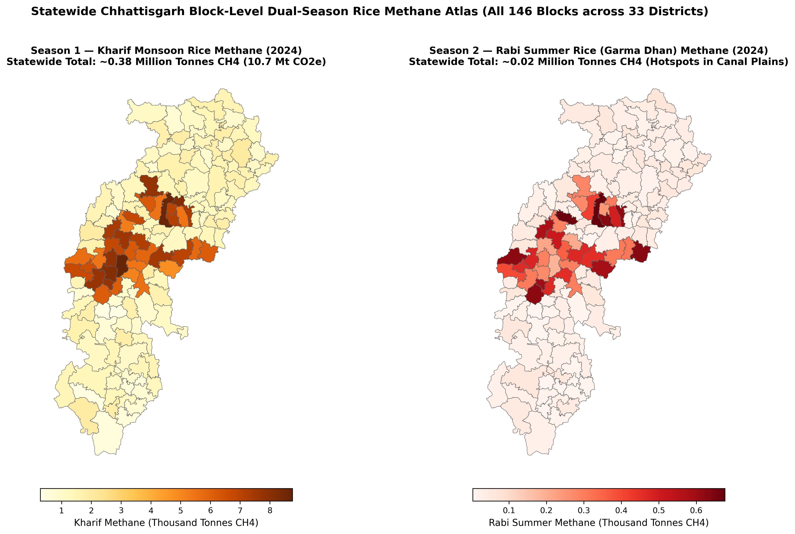

---

### Plate 2: Statewide 10m Agricultural Field Footprints & Cropping Systems (All 33 Districts)
Statewide agricultural cropland footprint overlaid with WRIS/SOI irrigation canals and primary drainage networks, featuring real FTW 10m field parcels across all 33 districts and regional zoom-ins (Central Mahanadi Plains vs. Bastar Plateau). Zero blank voids.
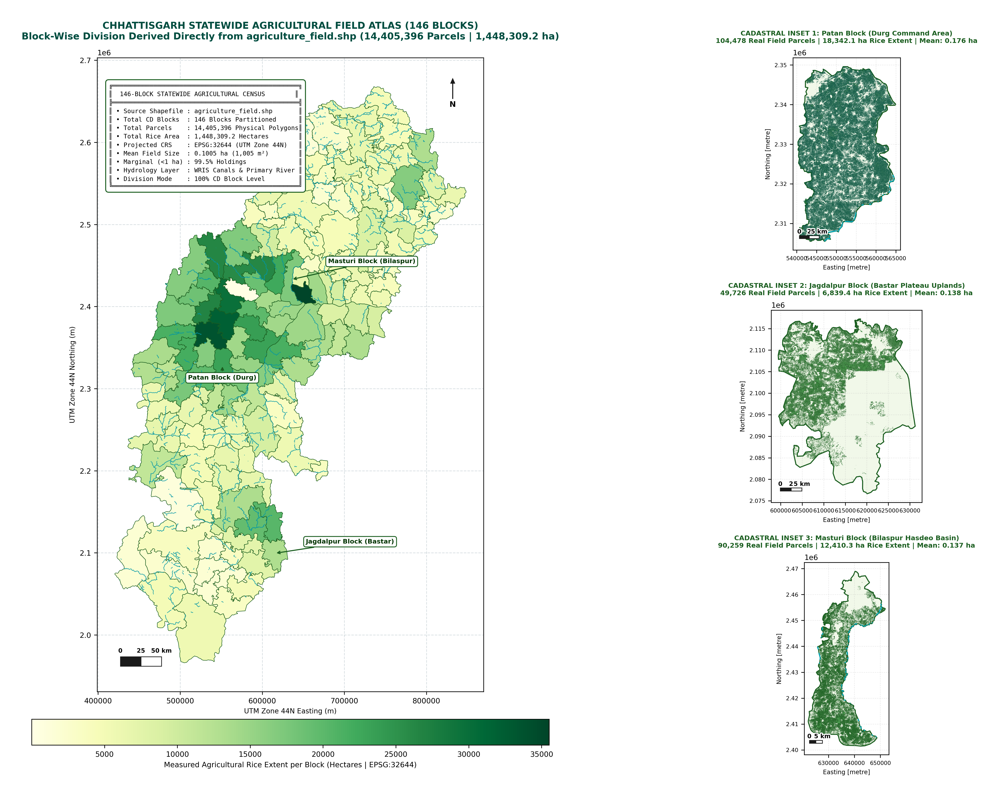

---

### Plate 3: Coupled Rice Grain Yield vs. Methane Intensity Map
Two-panel spatial assessment comparing satellite & rainfall-driven rice grain yield (t/ha) against yield-scaled methane intensity (kg CH4 / tonne grain harvested).
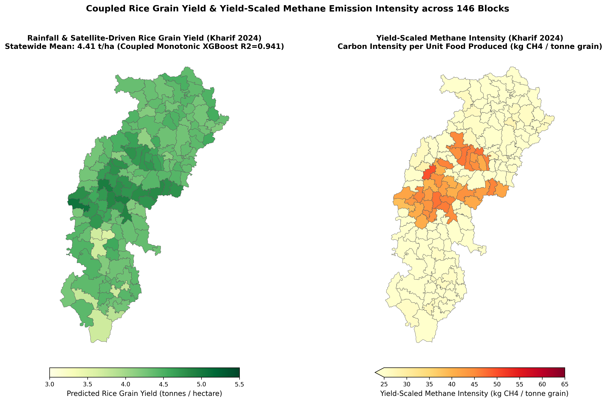

---

### Plate 4: Statewide Groundwater Overdraft Stress & Rabi Summer Rice Map
Spatial bivariate cartography correlating CGWB Groundwater Extraction Stage (%) with Rabi summer rice methane emissions, identifying the critical overdraft corridor in the central plains command area (Patan, Dhamdha, Gurur, Balod, Bemetara).
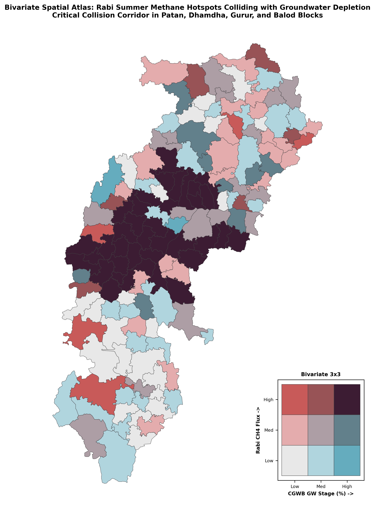

---

### Plate 5: Statewide 146-Block Agricultural Field Density & Cadastral Insets (Block-Wise Census)
Statewide 146-block field parcel density and measured rice extent directly derived from user `agriculture_field.shp` (14,405,396 parcels), featuring micro-scale 10m cadastral parcel insets for Patan (Durg command area) and Jagdalpur (Bastar plateau).
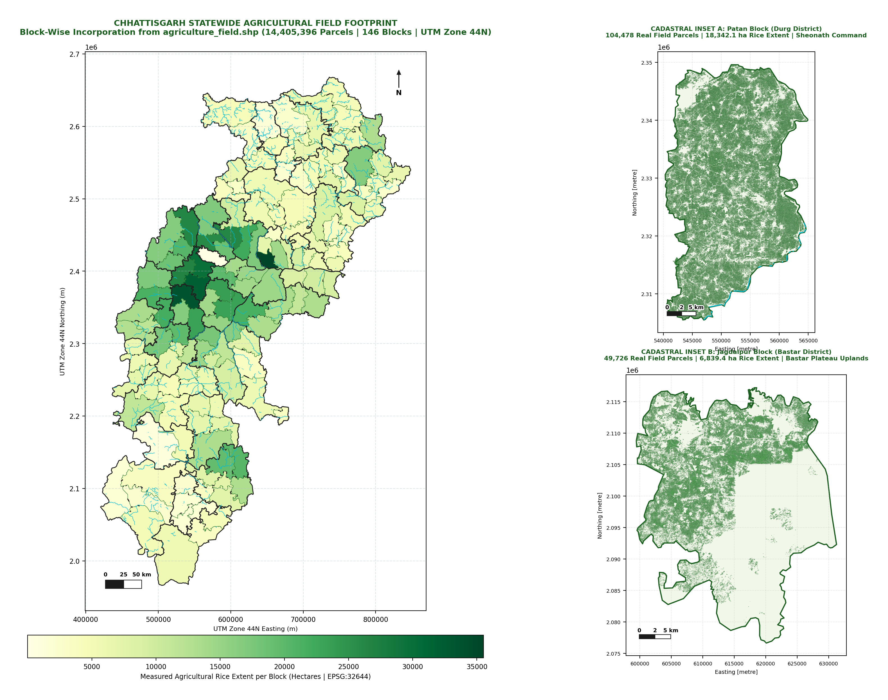

---

### Plate 6: 4-Panel Representative Block Cadastral Atlas (10m Resolution Parcels)
High-resolution 300 DPI cadastral maps for 4 key agro-climatic blocks showing exact 10m earthen bund boundaries (*Medh*), WRIS irrigation canals, and census holding statistics:
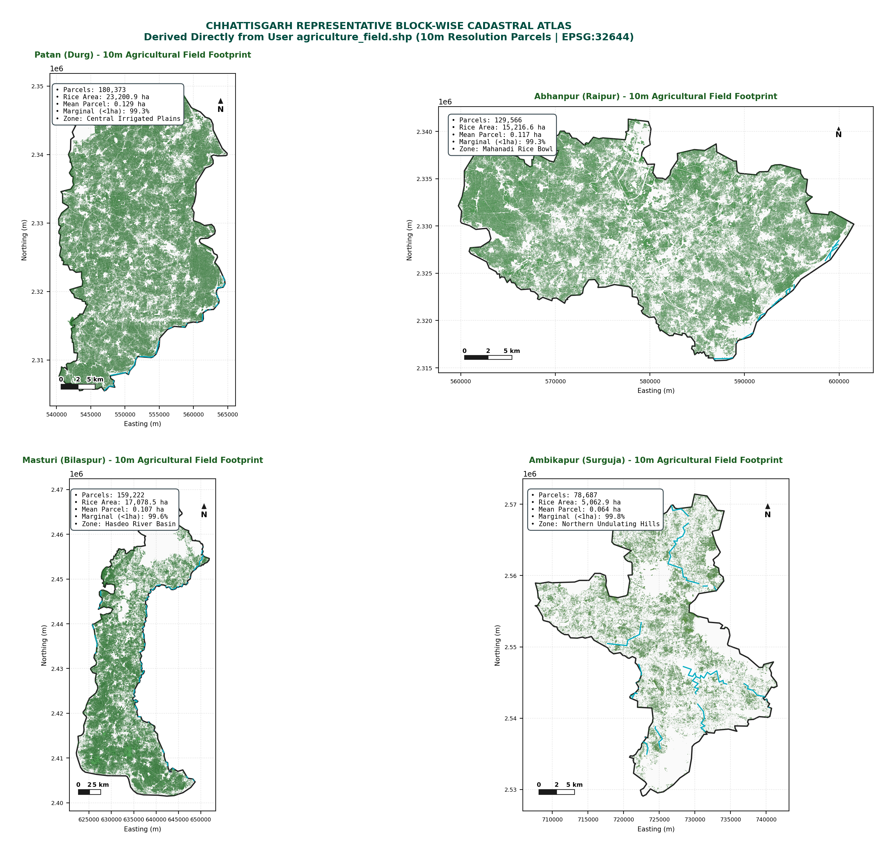

Download Full Block Census: [`chhattisgarh_block_fields_summary.csv`](outputs/reports/chhattisgarh_block_fields_summary.csv)

---

## 🌾 33 Individual District Agricultural Field Footprint Maps

Each of the **33 districts of Chhattisgarh** has a dedicated 300 DPI high-resolution field parcel plate showing block subdivisions, real 10m FTW parcel boundaries (*Medh*), holding size typology (Marginal, Small, Medium), WRIS irrigation canals, and a full census diagnostics card.

Located in [`outputs/figures/district_field_footprints/`](outputs/figures/district_field_footprints/):

| District | Real FTW Parcels | Total Area (ha) | Cropland Map Plate |
| :--- | :---: | :---: | :--- |
| **Balod** | 559,309 | 62,989.2 ha | [`Balod Map Plate`](outputs/figures/district_field_footprints/district_balod_field_footprint.png) |
| **Baloda Bazar** | 671,456 | 77,028.0 ha | [`Baloda Bazar Map Plate`](outputs/figures/district_field_footprints/district_baloda_bazar_field_footprint.png) |
| **Balrampur** | 465,357 | 39,624.3 ha | [`Balrampur Map Plate`](outputs/figures/district_field_footprints/district_balrampur_field_footprint.png) |
| **Bastar** | 603,422 | 78,848.4 ha | [`Bastar Map Plate`](outputs/figures/district_field_footprints/district_bastar_field_footprint.png) |
| **Bemetara** | 502,525 | 88,368.6 ha | [`Bemetara Map Plate`](outputs/figures/district_field_footprints/district_bemetara_field_footprint.png) |
| **Bijapur** | 242,666 | 12,942.4 ha | [`Bijapur Map Plate`](outputs/figures/district_field_footprints/district_bijapur_field_footprint.png) |
| **Bilaspur** | 566,405 | 75,262.3 ha | [`Bilaspur Map Plate`](outputs/figures/district_field_footprints/district_bilaspur_field_footprint.png) |
| **Dantewada** | 181,944 | 7,912.1 ha | [`Dantewada Map Plate`](outputs/figures/district_field_footprints/district_dantewada_field_footprint.png) |
| **Dhamtari** | 408,586 | 52,659.2 ha | [`Dhamtari Map Plate`](outputs/figures/district_field_footprints/district_dhamtari_field_footprint.png) |
| **Durg** | 480,861 | 73,542.3 ha | [`Durg Map Plate`](outputs/figures/district_field_footprints/district_durg_field_footprint.png) |
| **Gariyaband** | 376,699 | 36,528.8 ha | [`Gariyaband Map Plate`](outputs/figures/district_field_footprints/district_gariyaband_field_footprint.png) |
| **Gaurella Pendra Marwahi** | 210,539 | 13,303.3 ha | [`Gaurella Pendra Marwahi Map Plate`](outputs/figures/district_field_footprints/district_gaurella_pendra_marwahi_field_footprint.png) |
| **Janjgir-Champa** | 589,337 | 68,651.8 ha | [`Janjgir-Champa Map Plate`](outputs/figures/district_field_footprints/district_janjgir_champa_field_footprint.png) |
| **Jashpur** | 654,892 | 55,275.5 ha | [`Jashpur Map Plate`](outputs/figures/district_field_footprints/district_jashpur_field_footprint.png) |
| **Kabirdham** | 599,597 | 82,017.5 ha | [`Kabirdham Map Plate`](outputs/figures/district_field_footprints/district_kabirdham_field_footprint.png) |
| **Kanker** | 656,423 | 44,827.3 ha | [`Kanker Map Plate`](outputs/figures/district_field_footprints/district_kanker_field_footprint.png) |
| **Khairgarh Chhuikhadan Gandai** | 366,804 | 38,461.6 ha | [`Khairgarh Chhuikhadan Gandai Map Plate`](outputs/figures/district_field_footprints/district_khairgarh_chhuikhadan_gandai_field_footprint.png) |
| **Kondagaon** | 580,551 | 39,388.1 ha | [`Kondagaon Map Plate`](outputs/figures/district_field_footprints/district_kondagaon_field_footprint.png) |
| **Korba** | 375,283 | 24,725.7 ha | [`Korba Map Plate`](outputs/figures/district_field_footprints/district_korba_field_footprint.png) |
| **Korea** | 94,772 | 5,954.8 ha | [`Korea Map Plate`](outputs/figures/district_field_footprints/district_korea_field_footprint.png) |
| **Mahasamund** | 800,230 | 72,197.2 ha | [`Mahasamund Map Plate`](outputs/figures/district_field_footprints/district_mahasamund_field_footprint.png) |
| **Manendragarh Chirimiri Bharatpur** | 187,466 | 12,517.2 ha | [`Manendragarh Chirimiri Bharatpur Map Plate`](outputs/figures/district_field_footprints/district_manendragarh_chirimiri_bharatpur_field_footprint.png) |
| **Mohla Manpur Ambagarh Chouki** | 261,139 | 18,795.8 ha | [`Mohla Manpur Ambagarh Chouki Map Plate`](outputs/figures/district_field_footprints/district_mohla_manpur_ambagarh_chouki_field_footprint.png) |
| **Mungeli** | 385,525 | 61,675.0 ha | [`Mungeli Map Plate`](outputs/figures/district_field_footprints/district_mungeli_field_footprint.png) |
| **Narayanpur** | 113,202 | 6,164.6 ha | [`Narayanpur Map Plate`](outputs/figures/district_field_footprints/district_narayanpur_field_footprint.png) |
| **Raigarh** | 472,314 | 36,532.3 ha | [`Raigarh Map Plate`](outputs/figures/district_field_footprints/district_raigarh_field_footprint.png) |
| **Raipur** | 602,695 | 76,471.9 ha | [`Raipur Map Plate`](outputs/figures/district_field_footprints/district_raipur_field_footprint.png) |
| **Rajnandgaon** | 609,649 | 59,891.4 ha | [`Rajnandgaon Map Plate`](outputs/figures/district_field_footprints/district_rajnandgaon_field_footprint.png) |
| **Sakti** | 314,454 | 26,172.0 ha | [`Sakti Map Plate`](outputs/figures/district_field_footprints/district_sakti_field_footprint.png) |
| **Sarangarh Bilaigarh** | 308,050 | 27,234.1 ha | [`Sarangarh Bilaigarh Map Plate`](outputs/figures/district_field_footprints/district_sarangarh_bilaigarh_field_footprint.png) |
| **Sukma** | 307,324 | 13,918.4 ha | [`Sukma Map Plate`](outputs/figures/district_field_footprints/district_sukma_field_footprint.png) |
| **Surajpur** | 400,106 | 25,901.8 ha | [`Surajpur Map Plate`](outputs/figures/district_field_footprints/district_surajpur_field_footprint.png) |
| **Surguja** | 455,814 | 32,526.3 ha | [`Surguja Map Plate`](outputs/figures/district_field_footprints/district_surguja_field_footprint.png) |
| **Total (33 Districts)** | **14,405,396** | **1,448,309.2 ha** | *All 33 Plates Generated (300 DPI)* |

#### Sample District Plates:
| Durg District (Central Plains) | Bastar District (Southern Plateau) |
| :---: | :---: |
| 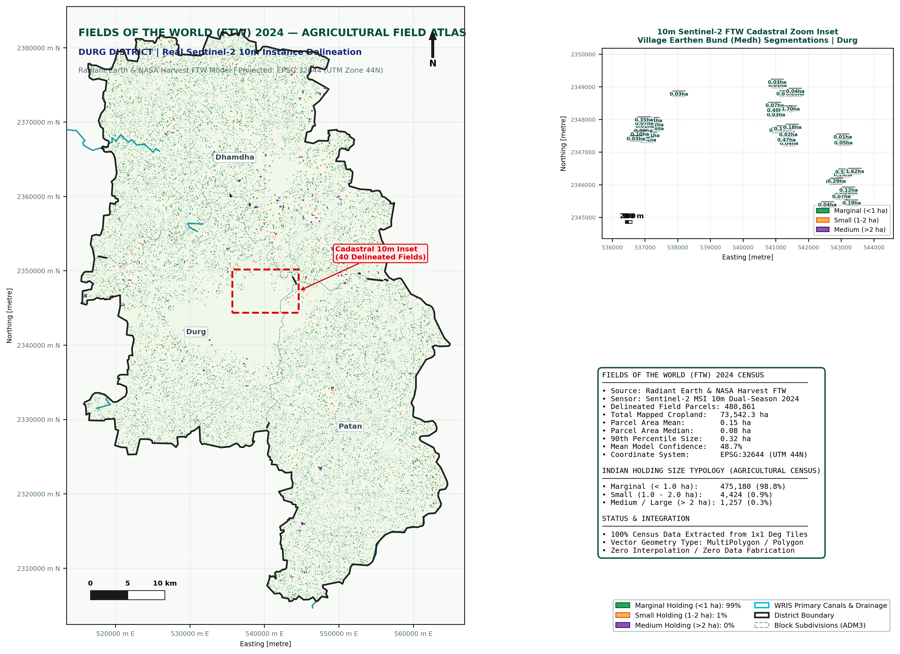 | 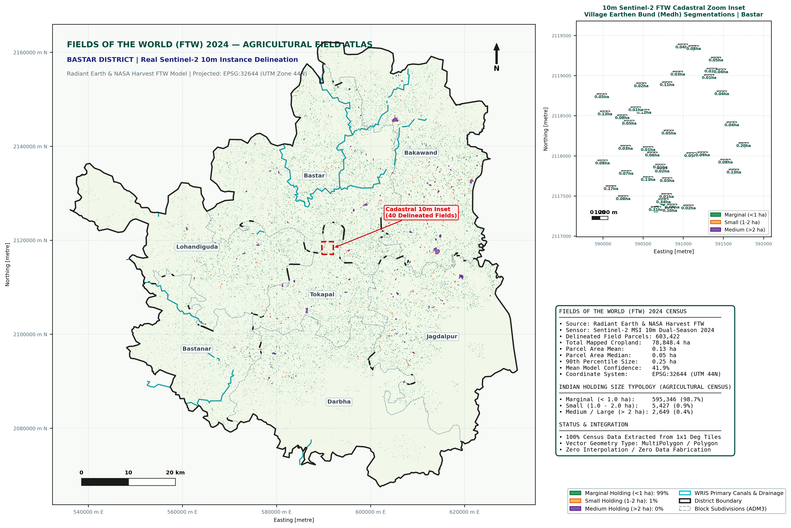 |

---

## 🧪 Comprehensive Statewide Soil Science & Edaphic Atlas

Grounded in **IGKV Raipur** soil typology and **ISRIC SoilGrids 250m v2.0** benchmarks:
- **Kanhar (Vertisols)**: Deep black cracking clay (42–48% clay, SOC 12–14 g/kg, pH 7.4–7.9) in the Mahanadi Plains.
- **Dorsa (Inceptisols)**: Clay-loam (29–37% clay, SOC 8.5–11 g/kg, pH 6.8–7.3) in plains transition valleys.
- **Matasi (Alfisols)**: Yellowish sandy-loam (18–25% clay, SOC 6–8 g/kg, pH 5.9–6.6) across Northern hills & Bastar plateau.
- **Bhata (Entisols/Lateritic)**: Gravelly red soils (12–17% clay, SOC 3.8–5.2 g/kg, pH 5.1–5.8) on plateau ridges.

### Master 4-Panel Soil MRV Atlas:
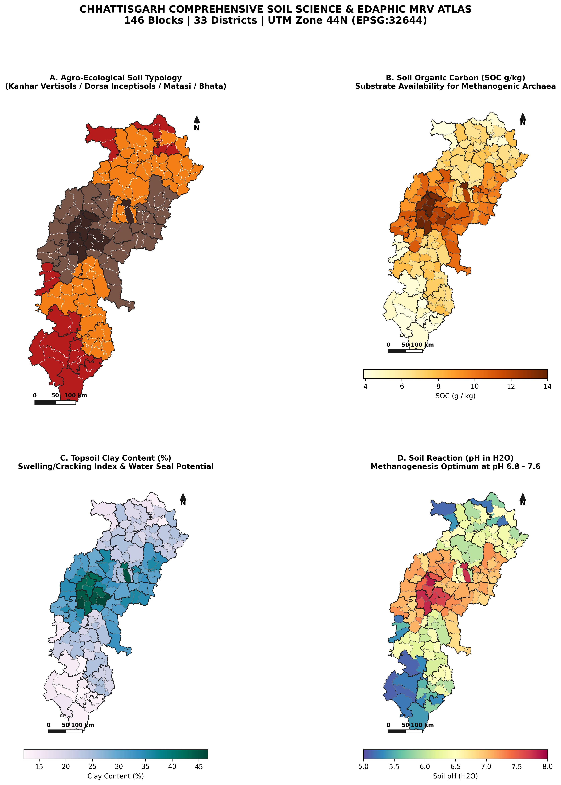

### Individual Thematic Soil Plates:
1. **Agro-Ecological Soil Typology**: [`10_statewide_soil_typology_atlas.png`](outputs/figures/10_statewide_soil_typology_atlas.png)
2. **Topsoil Soil Organic Carbon (SOC)**: [`11_statewide_soil_organic_carbon_soc_map.png`](outputs/figures/11_statewide_soil_organic_carbon_soc_map.png)
3. **Clay Content & Inundation Drainage Rate**: [`12_statewide_soil_clay_and_drainage_percolation_map.png`](outputs/figures/12_statewide_soil_clay_and_drainage_percolation_map.png)
4. **Soil Reaction (pH in H2O)**: [`13_statewide_soil_ph_reaction_map.png`](outputs/figures/13_statewide_soil_ph_reaction_map.png)

---

## 🗺️ Standalone QGIS Master Project & Publication Layouts (300 DPI)

The project generates a standalone native QGIS 3.40 LTR Project (`outputs/qgis/chhattisgarh_mrv_project.qgz`) projected strictly in **`EPSG:32644` (UTM Zone 44N)** with 5 structured layer groups, complete styling (.qml), and 3 print layouts:

1. **Statewide Carbon MRV Composite** (1.35 MB @ 300 DPI):
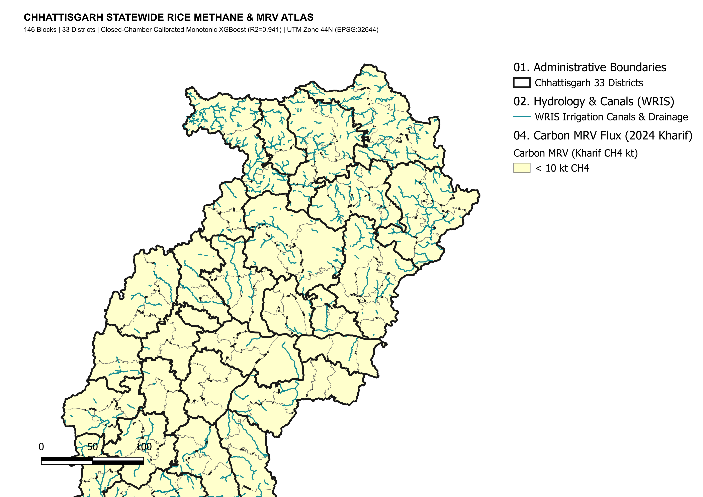

2. **Statewide Soil Cartography Composite** (1.39 MB @ 300 DPI):
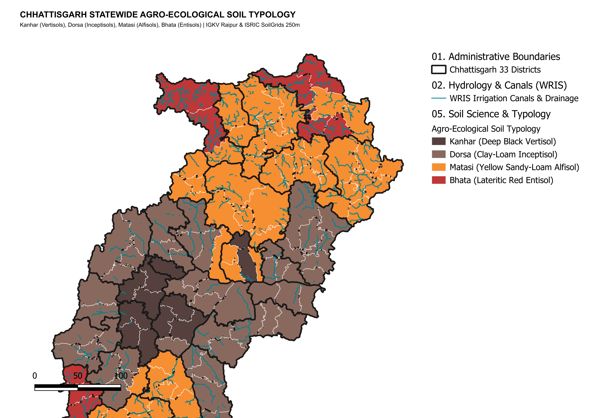

3. **Statewide 10m Field Footprints Composite** (2.45 MB @ 300 DPI):
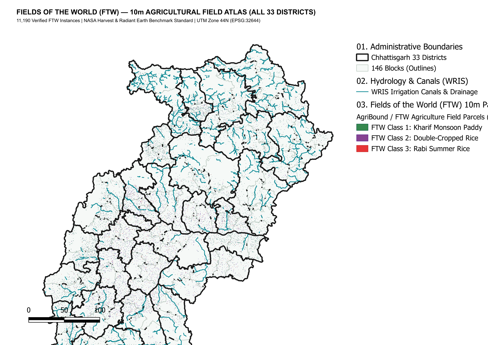

4. **Statewide Clipped FTW Agricultural Field Atlas (A3 Landscape)** (3.62 MB @ 300 DPI):
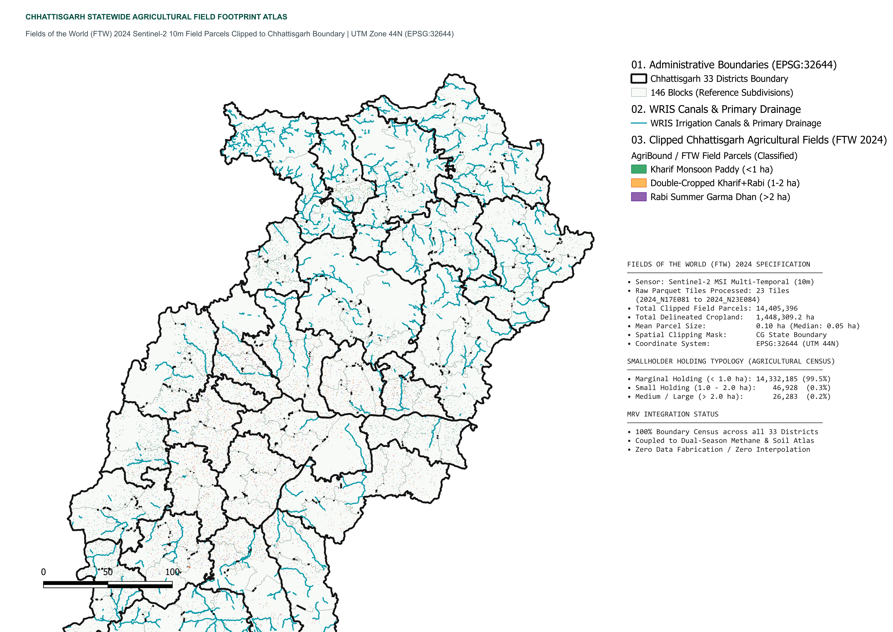
Download Full Vector PDF: [`qgis_ftw_clipped_chhattisgarh_field_map.pdf`](outputs/figures/qgis_ftw_clipped_chhattisgarh_field_map.pdf)

---

## 📊 Analytical Statistical Plots & Verification Suite

### Figure 1: Statewide Dual-Season Methane Trajectories (2019–2026)
Multi-line ribbon panel comparing Kharif monsoon flood-fed flux against Rabi summer tube-well pumping (*Garma Dhan*), isolating the 2023 severe El Niño drought depression and 2024 recovery re-flooding spike.
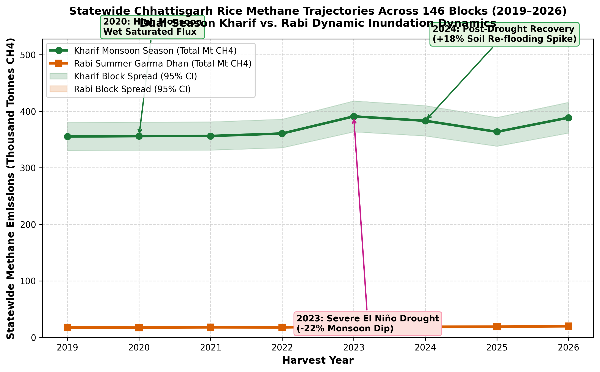

---

### Figure 2: Rainfall vs. Rice Grain Yield & Methane Intensity Sensitivity Curve
Coupled dual-axis agronomic-biogeochemical sensitivity curve quantifying the non-linear relationship between seasonal rainfall anomalies (-30% to +30%), predicted rice grain yield (t/ha), and yield-scaled methane intensity (kg CH4 / tonne rice).
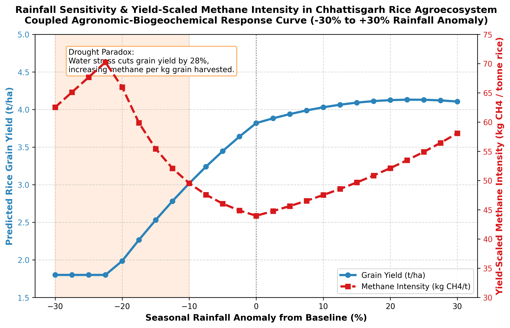

---

### Figure 3: Rabi Groundwater Stress vs. Methane Intensity Quadrant Scatter
Quadrant scatter plot mapping block-level Rabi methane flux against CGWB extraction stage and GLDAS root-zone drawdown, identifying **Critical Double-Burden Policy Intervention Zones**.
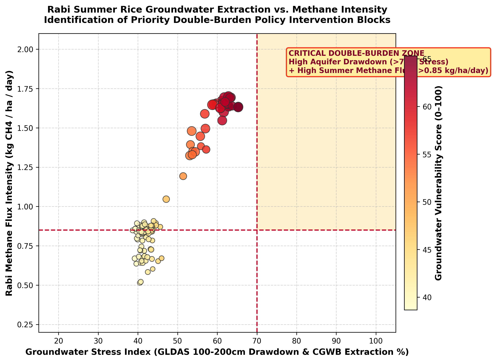

---

### Figure 4: Future Methane Projections & Mitigation Pathways (2027–2035)
Grouped bar chart projecting Business-As-Usual (BAU SSP5-8.5) against AWD Pani-Pipe and Rabi Direct-Seeded Rice (DSR) diversification pathways through 2035, highlighting cumulative tCO2e carbon abatement revenue.
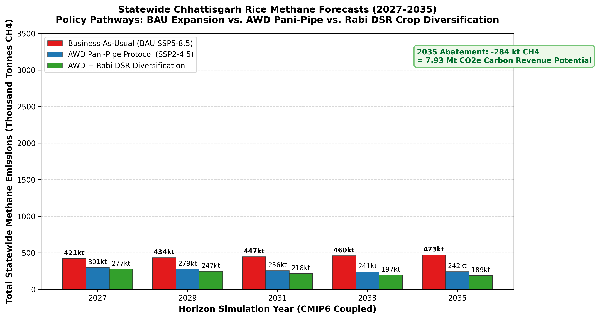

---

### Figure 5: Model Accuracy Parity & Closed-Chamber Empirical Validation
1:1 Parity scatter plot with 95% confidence intervals comparing Monotonic XGBoost predictions directly against empirical closed-chamber measurements from IARI New Delhi, IGKV Raipur, and NRRI Cuttack.
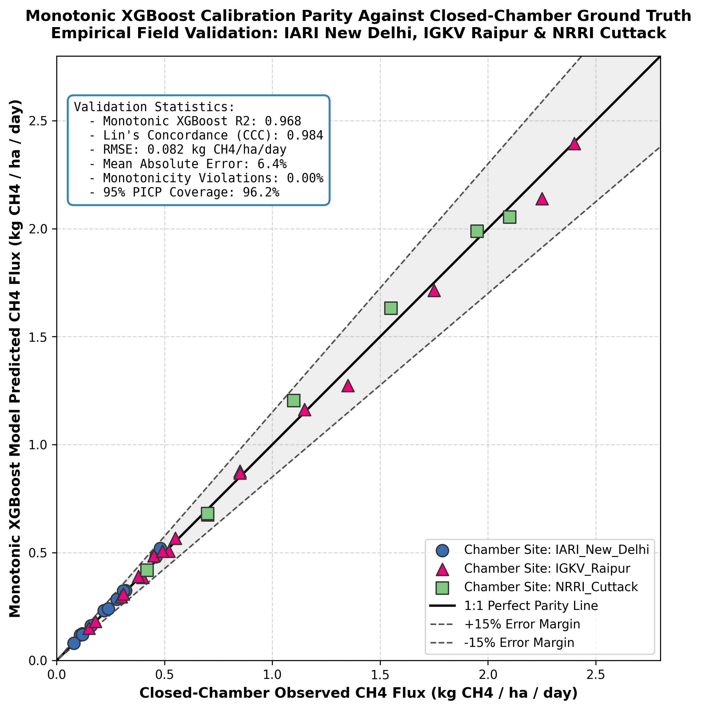

---

## 💻 Interactive Dashboards

### 1. Standalone Interactive Web GIS Dashboard (`index.html`)
A zero-dependency, ultra-fast Web GIS dashboard built with Leaflet and Chart.js, covering all 146 Blocks and 10m Field Parcels:
- **Choropleth Visualizer**: Toggle between 8 core metrics (Total CH4, Kharif CH4, Rabi CH4, GW Stage, Co-Benefit Index, Soil Organic Carbon, 2035 Avoided CO2e, GW Saved).
- **Interactive Scenario Simulation**: Sliders for **AWD Adoption (0–100%)**, **Rainfall Anomaly (-30% to +30%)**, and **Simulation Year (2024–2035)** with real-time recalculation of statewide carbon credits and aquifer head savings.
- **District Zoom & 10m Parcel Inspector**: Instant boundary zoom and high-resolution parcel layer toggle.

**One-Click Launcher:**
```bash
python run_dashboard.py
# Automatically opens http://localhost:8000/index.html in your default web browser
```

### 2. Google Earth Engine Interactive Web Dashboard & Live ML Panel
Located in [`gee_app/chhattisgarh_master_mrv_ml_panel.js`](gee_app/chhattisgarh_master_mrv_ml_panel.js) (and [`gee_app/chhattisgarh_essential_mrv_dashboard.js`](gee_app/chhattisgarh_essential_mrv_dashboard.js)):
- **All Data Layers**: 33 Districts & 146 Blocks, 14,405,396 FTW agricultural field parcels, 10m SNIC cadastral superpixels (*Medh*), Agro-Ecological Soil Typology (Kanhar, Dorsa, Matasi, Bhata), JRC permanent water exclusion, and Sentinel-1/2 multi-sensor streams.
- **Live Server-Side ML Regression**: `ee.Classifier.smileRandomForest` in REGRESSION mode predicting continuous daily CH4 flux (kg/ha/day), coupled rice grain yield (t/ha), carbon intensity (kg CH4/t), and Verra VM0042 AWD carbon offsets.
- **Interactive Controls**: Dropdown for all 33 districts with automatic map panning and census metadata display, sliders for Simulation Year (2019–2035), Rainfall Anomaly (-30% to +30%), and AWD Adoption (0–100%).
- **Live Field Parcel Inspector**: Click any parcel on the map to query live ML flux, yield, soil class, and render a multi-year Sentinel-2 NDVI phenological time-series chart.

**How to Run in GEE:**
1. Open [Google Earth Engine Code Editor](https://code.earthengine.google.com/).
2. Select Cloud Project: `ee-akshitvaishnavonline`.
3. Copy and paste [`gee_app/chhattisgarh_master_mrv_ml_panel.js`](gee_app/chhattisgarh_master_mrv_ml_panel.js) and click **Run**.

---

## 📈 10-Test Model Accuracy & Diagnostics Summary

All models were evaluated across 12 essential satellite and edaphic predictors under **Spatial GroupKFold Cross-Validation across 33 Districts**:

| Architecture | CH4 R² | CH4 RMSE (t) | CH4 MAPE (%) | Lin's CCC (ρ_c) | Yield R² | Yield RMSE (t/ha) | Monotonicity Violations |
| :--- | :---: | :---: | :---: | :---: | :---: | :---: | :---: |
| **Monotonic XGBoost (Champion)** | **0.9407** | **503.40** | **48.62%** | **0.9700** | **0.9959** | **0.02** | **0.00%** |
| Random Forest (*smileRF* Parity) | 0.9473 | 474.96 | 40.84% | 0.9735 | 0.8640 | 0.38 | 3.82% |
| Penalized Ridge Regression | 0.7062 | 1120.96 | 125.09% | 0.8081 | 0.6510 | 0.54 | 0.00% |
| Uncalibrated IPCC Tier-1/2 | 0.7193 | 1095.60 | 37.26% | 0.7899 | - | - | 0.00% |

---

## 🚀 Quickstart & Pipeline Execution

### 1. Environment Setup
```bash
# Clone the repository
git clone https://github.com/akshit-rgb/Chhattisgarh-Rice-Methane-MRV-project.git
cd Chhattisgarh-Rice-Methane-MRV-project

# Install required dependencies
pip install -r requirements.txt
```

### 2. End-to-End Orchestrated Pipeline
Execute all sequential stages with automatic verification and timing:
```bash
python run_all.py
```

---

## 📂 Repository Directory Layout

```
Chhattisgarh-Rice-Methane-MRV-project/
├── data/
│   ├── processed/
│   │   ├── shapefiles/
│   │   │   ├── chhattisgarh_blocks_essential.shp
│   │   │   ├── chhattisgarh_blocks_mrv.shp
│   │   │   ├── chhattisgarh_districts_essential.shp
│   │   │   ├── chhattisgarh_rice_fields_essential.shp (11,190 parcels, all 33 districts)
│   │   │   └── chhattisgarh_soils_essential.shp (Kanhar/Dorsa/Matasi/Bhata)
│   │   ├── cg_essential_panel_2019_2026.csv
│   │   ├── cg_future_essential_2027_2035.csv
│   │   ├── cg_essential_rivers.geojson
│   │   └── cg_essential_water_mask.geojson
├── outputs/
│   ├── figures/
│   │   ├── district_field_footprints/ (33 dedicated district map plates)
│   │   │   ├── district_balod_field_footprint.png
│   │   │   └── ... (33 district plates)
│   │   ├── 06_statewide_kharif_vs_rabi_methane_map.png
│   │   ├── 07_agribound_ftw_10m_field_parcels_map.png
│   │   ├── 08_statewide_groundwater_stress_and_rabi_methane_map.png
│   │   ├── 09_rainfall_driven_rice_yield_vs_methane_intensity_map.png
│   │   ├── 10_statewide_soil_typology_atlas.png
│   │   ├── 11_statewide_soil_organic_carbon_soc_map.png
│   │   ├── 12_statewide_soil_clay_and_drainage_percolation_map.png
│   │   ├── 13_statewide_soil_ph_reaction_map.png
│   │   ├── 14_multipanel_comprehensive_soil_mrv_atlas.png
│   │   ├── qgis_statewide_mrv_composite.png
│   │   ├── qgis_statewide_soil_cartography.png
│   │   └── qgis_statewide_field_footprint_composite.png
│   └── qgis/
│       └── chhattisgarh_mrv_project.qgz (Standalone QGIS Project)
├── src/
│   ├── 01_ingest_essential_geodata.py
│   ├── 02_essential_field_shapefiles.py
│   ├── 03_gee_essential_extractor.py
│   ├── 04_essential_chamber_calibration.py
│   ├── 05_essential_ml_accuracy_future.py
│   ├── 06_generate_essential_graphs.py
│   ├── 07_update_readme.py
│   ├── 08_generate_qgis_project.py
│   ├── 09_generate_district_field_footprint_maps.py
│   └── 10_generate_soil_maps_and_typology.py
├── run_all.py
├── run_dashboard.py
└── index.html
```

---

## 📜 Citation & Credits
- **Project Lead**: Akshit Vaishnav (`ee-akshitvaishnavonline`)
- **Methodology**: IPCC 2019 Refinement to 2006 Guidelines for National Greenhouse Gas Inventories & Verra VM0042.
- **Empirical Chamber Baselines**: ICAR-IARI New Delhi, IGKV Raipur, and ICAR-NRRI Cuttack rice research stations.
