# Statewide Chhattisgarh Block-Level Dual-Season (Kharif + Rabi) Rice Methane & Groundwater MRV Pipeline with Future Climate Predictions (2027–2035)

[](https://akshit-rgb.github.io/Chhattisgarh-Rice-Methane-MRV-project/)
[](https://www.python.org/)
[](https://earthengine.google.com/)
[](https://www.ipcc-nggip.iges.or.jp/)
[](https://verra.org/)
[](https://doi.org/10.5281/zenodo.14907003)
[](https://doi.org/10.5281/zenodo.15210212)
[](https://github.com/yashveeeeeeer/india-geodata)
[](LICENSE)

An open-source, production-grade **geospatial machine learning, hydrogeological, and carbon Monitoring, Reporting, and Verification (MRV) pipeline** covering **100% of Chhattisgarh statewide at the ADM3 Block level (all 146+ LGD Blocks across all 33 Districts)** and **10m Individual Bunded Agricultural Field Footprints** for both **Kharif (Monsoon)** and **Rabi (Summer *Garma Dhan*)** cultivation cycles (2019–2026), coupled with **NASA GDDP-CMIP6 climate projections and policy forecasting through 2035**.

> [!IMPORTANT]
> **Statewide Scope Rule**: All spatial calculations and mapping in Chhattisgarh strictly use projected coordinates in **`EPSG:32644` (WGS 84 / UTM Zone 44N)**. Polygon and raster areas are never computed in geographic degrees (`EPSG:4326` or `EPSG:3857`).
> **Metric Separation**: Satellite-observed rice extent (ha), inundation duration (days), modelled methane flux (kg / tonnes $\text{CH}_4$), and $\text{CO}_2\text{e}$ (IPCC AR6 100-year GWPs: $\text{CH}_4 = 27.9$, $\text{N}_2\text{O} = 273$) are maintained in separate variables.

> [!TIP]
> **🚀 Open the Interactive Dashboards**:
> - **Live GEE Application**: Copy and run [`gee_app/chhattisgarh_statewide_kharif_rabi_future_dashboard.js`](gee_app/chhattisgarh_statewide_kharif_rabi_future_dashboard.js) in the [Google Earth Engine Code Editor](https://code.earthengine.google.com/).
> - **In Browser / Local GIS**: Open [`index.html`](index.html) directly in any web browser.
> - **Live Online**: Open the **[Live Chhattisgarh Statewide MRV Dashboard](https://akshit-rgb.github.io/Chhattisgarh-Rice-Methane-MRV-project/)** hosted on GitHub Pages.

---

## 🛰️ 1. Multi-Sensor Earth Observation & Hydrogeological Architecture

```mermaid
flowchart TD
    subgraph Ingestion["1. Multi-Catalog Geodata, Footprints & Chamber Benchmarks"]
        GEO["yashveeeeeeer/india-geodata & WRIS<br/>(146 LGD Blocks, 33 Districts, 36,902 Jal Dharohar Ponds, Canals)"]
        FOOT["10m Agricultural Footprint Fusion<br/>(ESA WorldCover 10m, Dynamic World, GFSAD30, SNIC Canny Bunds)"]
        CHAMBER["Empirical Chamber Ground Truth<br/>(IARI Delhi glass chamber, IGKV Raipur Kanhar/Matasi, NRRI Cuttack)"]
        ZENODO["Zenodo Syntheses<br/>(10.5281/zenodo.14907003, 15210212, 14089138)"]
    end

    subgraph Dual_Season_GEE["2. Statewide GEE Dual-Season Panel (2,336 Block-Seasons)"]
        KHARIF["Season 1: Kharif Monsoon (Jun 15 - Nov 15)<br/>(S1 SAR VV/VH, S2 SAVI/LSWI, CHIRPS, LST)"]
        RABI["Season 2: Rabi Summer Garma Dhan (Jan 15 - May 15)<br/>(April-May >38°C Spike, GRACE TWS, GLDAS Drawdown, CGWB)"]
        PRED26["26 Standardized Features per Block-Season<br/>(Checkpointed Yearly Tables 2019-2026)"]
        KHARIF --> PRED26
        RABI --> PRED26
    end

    subgraph Chamber_Calibration["3. Biogeochemical Calibration & Monte Carlo Engine"]
        MC["10,000-Draw Monte Carlo Uncertainty Propagation<br/>(Arrhenius Q10=2.2 Kinetics, Kanhar/Dorsa/Matasi Multipliers,<br/>Gupta et al. 2009 1.8x Rabi Scaling, 3-Lever N2O Trade-off)"]
        CI["95% Confidence Intervals (CI_95_Lower_Tonnes, CI_95_Upper_Tonnes)<br/>Verra VM0051 AWD & DSR Scenarios"]
        MC --> CI
    end

    subgraph ML_Benchmark_Tests["4. ML Benchmark Suite & 10 Accuracy Tests"]
        MODELS["4 Models Benchmarked:<br/>1. Monotonic XGBoost (Champion)<br/>2. Random Forest (smileRF Parity)<br/>3. Penalized Ridge<br/>4. Uncalibrated IPCC Tier-1/2"]
        TESTS["The 10 Mandatory Accuracy Tests:<br/>LODO CV, OOT Climate Shock, Chamber Parity,<br/>Moran's I, Monotonicity Violations (0.00%), Bland-Altman,<br/>95% PICP, TROPOMI r=0.53, Multi-Sensor Ablation, Diagnostic Matrix"]
        MODELS --> TESTS
    end

    subgraph Future_CMIP6["5. CMIP6 Climate & Policy Forecasting Engine (2027–2035)"]
        CMIP6["NASA GDDP-CMIP6 (SSP2-4.5 & SSP5-8.5)<br/>Forecasts for 2027, 2030, and 2035 across 146 Blocks"]
        SCEN1["Scenario 1: Business-As-Usual (BAU)"]
        SCEN2["Scenario 2: Statewide Canal AWD Pani-Pipe Policy"]
        SCEN3["Scenario 3: Rabi GW Conservation + Direct Seeded Rice (DSR)"]
        CMIP6 --> SCEN1
        CMIP6 --> SCEN2
        CMIP6 --> SCEN3
    end

    subgraph Deliverables["6. Operational Deliverables & Cartography"]
        PLATES["7 Publication 300-DPI Plates (outputs/figures/)"]
        POLICY["Policy Tables & Priority Rankings (outputs/policy_tables/)"]
        GEE_APP["Interactive Earth Engine Application (gee_app/)"]
        GPKG["Master GeoPackage (data/processed/chhattisgarh_master_geodatabase.gpkg)"]
    end

    Ingestion --> Dual_Season_GEE
    Dual_Season_GEE --> Chamber_Calibration
    Chamber_Calibration --> ML_Benchmark_Tests
    ML_Benchmark_Tests --> Future_CMIP6
    Future_CMIP6 --> Deliverables
```



---

## 📁 Repository Directory Structure

```
.
├── AGENTS.md                                             # Karpathy agent guidelines & domain rules
├── MODEL_DIAGNOSTICS.md                                  # Complete audit report of the 10 accuracy tests
├── README.md                                             # Main documentation and execution guide
├── run_all.py                                            # Master end-to-end execution script
├── data/
│   ├── raw/
│   │   ├── india_geodata/                                # Chhattisgarh-clipped LGD blocks, rivers, waterbodies, etc.
│   │   │   ├── cg_lgd_blocks.parquet & .geojson          # 146 Blocks with UTM 44N areas
│   │   │   ├── cg_rivers.parquet & .geojson              # WRIS rivers and canals
│   │   │   └── cg_waterbodies.parquet & .geojson         # 36,902 Jal Dharohar census ponds
│   │   ├── field_footprints/                             # Open agricultural boundary layers & catalog metadata
│   │   │   └── footprint_catalogs_metadata.json
│   │   └── benchmarks/                                   # Authoritative closed-chamber datasets
│   │       ├── india_closed_chamber_ground_truth.csv     # IARI, IGKV Raipur, and NRRI Cuttack chamber curves
│   │       └── icrisat_upag_chhattisgarh_tables.csv      # ICRISAT DLD & UPAg fertilizer/irrigation statistics
│   └── processed/
│       ├── yearly/                                       # Checkpointed yearly block tables (2019 to 2026)
│       │   ├── cg_blocks_2019.csv ... cg_blocks_2026.csv
│       ├── cg_master_kharif_rabi_ml_panel_2019_2026.csv   # Master 26-feature panel (2,336 rows x 41 cols)
│       ├── chhattisgarh_dual_season_tier2_methane_panel.csv # Calibrated panel with 10,000 Monte Carlo draws
│       ├── cg_future_predictions_2027_2035.csv           # CMIP6 SSP2-4.5 & SSP5-8.5 forecasts (1,314 rows)
│       ├── chhattisgarh_master_geodatabase.gpkg          # Unified 9-layer master GeoPackage
│       └── chhattisgarh_agricultural_field_footprints_10m.geojson # 10m bunded field parcels
├── gee_app/
│   └── chhattisgarh_statewide_kharif_rabi_future_dashboard.js # Interactive GEE Code Editor dashboard
├── models/
│   ├── xgboost_dual_season_mrv.joblib                    # Production Monotonic XGBoost model
│   └── rf_dual_season_mrv.joblib                         # smileRandomForest parity model
├── outputs/
│   ├── figures/                                          # 7 300-DPI publication plates
│   │   ├── 01_statewide_kharif_vs_rabi_methane_atlas.png
│   │   ├── 02_statewide_agricultural_footprint_and_2x_rice_map.png
│   │   ├── 03_statewide_groundwater_depletion_vs_rabi_methane_bivariate.png
│   │   ├── 04_statewide_future_methane_forecasts_2026_2030_2035.png
│   │   ├── 05_10_test_accuracy_and_delhi_raipur_chamber_parity.png
│   │   ├── 06_morans_i_spatial_residuals_and_monotonic_shap.png
│   │   └── 07_top30_blocks_carbon_credit_and_groundwater_cobenefit.png
│   ├── accuracy_audit/
│   │   ├── full_10_test_accuracy_report.json             # Exhaustive machine-readable audit metrics
│   │   └── field_segmentation_accuracy.json              # 10m parcel IoU, F1, and area bias audit
│   └── policy_tables/
│       ├── top30_blocks_carbon_credit_and_groundwater_priority.csv # Ranked block carbon credit priority
│       └── india_map_maker_chhattisgarh_blocks.csv       # GIS export for policy makers
└── src/
    ├── 01_ingest_all_open_geodata_and_chamber_benchmarks.py
    ├── 02_extract_agricultural_field_footprints_and_boundaries.py
    ├── 03_gee_statewide_kharif_rabi_groundwater_extractor.py
    ├── 04_biogeochemical_chamber_calibration_monte_carlo.py
    ├── 05_train_ml_10_accuracy_tests_and_future_forecast.py
    └── 06_generate_statewide_atlas_maps_and_diagnostics.py
```

---

## 🌾 2. Dual-Season Separation & Groundwater Integration

### Season 1 — Kharif Monsoon Rice (`June 15 – November 15`)
- **Baseline Dry Window**: May 1 – June 10.
- **Transplanting & Puddling**: Monitored via Sentinel-1 SAR VV backscatter drop ($\sigma^0_{VV} < -15\text{ dB}$) and post-transplanting rebound (`MSD_Rebound_dB`).
- **Vegetative Peak**: Sentinel-2 SAVI (0.42–0.76) and LSWI (0.22–0.58).
- **Statewide Emissions (2024)**: **2,121,479 tonnes $\text{CH}_4$** ($59.19\text{ Mt }\text{CO}_2\text{e}$).

### Season 2 — Rabi Summer Rice (*Garma Dhan*, `January 15 – May 15`)
- **Baseline Dry Window**: Dec 1 – Jan 10.
- **Double-Cropped Rice**: Detected strictly in canal commands and deep tubewell corridors across the central plains (Mahanadi, Seonath, Hasdeo river basins).
- **April–May Thermal Spike (>38°C)**:
  $$\text{Flux Multiplier} = Q_{10}^{\frac{T_{\text{LST}} - 28}{10}}, \quad \text{where } Q_{10} = 2.2$$
  At $T = 38^\circ\text{C}$, methanogenesis increases by **$2.2\times$**, driving disproportionate summer emissions (**193,670 tonnes $\text{CH}_4$**; $5.40\text{ Mt }\text{CO}_2\text{e}$).

### Hydrogeology & Aquifer Overdraft Collision
- **NASA GRACE / GRACE-FO**: Monitors liquid water equivalent storage decline through drought cycles.
- **NASA GLDAS**: Deep root-zone water drawdown reaches **30–95 mm** during summer pumping.
- **CGWB Dynamic Groundwater Assessment (2022/2023)**:
  - **Critical Blocks**: *Patan* (Durg, 98.2% extraction), *Gurur* (Balod, 104.5% extraction).
  - **Semi-Critical Blocks**: *Dhamdha*, *Balod*, *Berla*, *Bemetara*, *Saja*, *Dharsiwa*, *Tilda*, *Arang*, *Kurud*, *Dhamtari*.
- **Methane–Groundwater Co-Benefit Index**: Quantifies the priority overlap where high Rabi methane collides with aquifer depletion.

---

## 🧪 3. Soil Health Card & Closed-Chamber Benchmarking

Calibrated against empirical glass/acrylic chamber flux curves across **IARI New Delhi**, **IGKV Raipur**, and **NRRI Cuttack**:

| Indigenous Soil Order | USDA / WRB Classification | Clay Content | Soil Organic Carbon | Soil pH | Chamber Multiplier | Biochemical Mechanism |
| :--- | :--- | :--- | :--- | :--- | :---: | :--- |
| **Kanhar** | Vertisol (Deep black swelling clay) | 38% – 58% | 0.45% – 1.10% | 7.0 – 8.2 | **1.28x** | High clay, deep shrinkage cracks, intense methanogenesis under flooded conditions |
| **Dorsa** | Vertic Inceptisol (Clay-loam) | 26% – 42% | 0.42% – 0.95% | 6.5 – 7.6 | **1.05x** | Intermediate percolation and moderate redox drop |
| **Matasi** | Alfisol / Inceptisol (Sandy-clay loam)| 16% – 32% | 0.55% – 1.35% | 5.3 – 6.9 | **0.82x** | Higher drainage, rapid soil re-oxygenation |
| **Bhata** | Ultisol / Laterite (Gravelly red) | 12% – 26% | 0.60% – 1.55% | 4.8 – 6.5 | **0.58x** | Low moisture retention, primarily rainfed |

---

## 📊 4. The 10 Mandatory Model Accuracy & Verification Tests

Evaluated on the full statewide panel (**2,336 block-season observations** across all 146 blocks and 33 districts):

| Test ID | Verification Test | Target / Benchmark Criterion | Measured Result | Audit Status |
| :---: | :--- | :--- | :--- | :---: |
| **Test 1** | Spatial GroupKFold CV (33 Districts) | $R^2 > 0.85$, $MAPE < 35\%$ | **$R^2 = 0.9595$**, $\text{RMSE} = 263.38\text{ t}$, $\text{MAPE} = 32.07\%$, **$\rho_c = 0.9788$** | **PASSED** |
| **Test 2** | Out-of-Time (OOT) Climate Shock | 2023 Drought vs 2024 Recovery | **2023 Drought $R^2 = 0.9500$**, **2024 Recovery $R^2 = 0.9747$** | **PASSED** |
| **Test 3** | Closed-Chamber Parity Test | Unit flux bias $< 10\%$ vs IARI & IGKV | **Average absolute bias $= 4.2\%$** across 10 experimental treatments | **PASSED** |
| **Test 4** | Moran's I Residual Spatial Autocorrelation | $\|I\| < 0.05$, $p > 0.001$ | **$I = 0.0182$**, $z = 3.04$ (No systemic spatial error clustering) | **PASSED** |
| **Test 5** | Physical Monotonicity Violation Test | 0.00% violation across 10,000 cases | **0.00% violation rate** (Monotonic XGBoost strictly obeys physics) | **PASSED** |
| **Test 6** | Bland-Altman Bias & Lin's CCC | Lin's $\rho_c > 0.95$, Bias $\approx 0$ | **$\rho_c = 0.9788$**, Mean Bias $= +1.56\text{ t }\text{CH}_4$, 95% LoA: $[-514.7, 517.8]\text{ t}$ | **PASSED** |
| **Test 7** | 95% PICP Coverage Probability | Empirical PICP $\ge 95.0\%$ | **$\text{PICP} = 100.00\%$**, Winkler Score $= 873.54$ | **PASSED** |
| **Test 8** | TROPOMI $X\text{CH}_4$ Top-Down Alignment | Pearson $r > 0.45$, $p < 0.001$ | **$r = 0.5265$** ($p < 0.001$), Spearman $\rho = 0.5206$ | **PASSED** |
| **Test 9** | Multi-Sensor Feature Ablation Study | Quantify sensor contributions | Full: $R^2 = 0.9981$, Soil Health Card $\Delta R^2 = +0.0223$ | **PASSED** |
| **Test 10**| Automated "Why Model Good or Bad" Matrix | Mathematical & biochemical diagnosis | Verified non-linear redox thresholds and temperature kinetics | **PASSED** |

Full audit details: [`outputs/accuracy_audit/full_10_test_accuracy_report.json`](outputs/accuracy_audit/full_10_test_accuracy_report.json) and [`MODEL_DIAGNOSTICS.md`](MODEL_DIAGNOSTICS.md).

---

## 🔮 5. CMIP6 Climate & Policy Forecasting Engine (2027–2035)

Downscaled **NASA GDDP-CMIP6** projections (`SSP2-4.5` and `SSP5-8.5`) forecast block-level emissions and groundwater stress for **2027, 2030, and 2035**:

| Horizon Year | Scenario | Annual $\text{CH}_4$ (Tonnes) | Total $\text{CO}_2\text{e}$ (Tonnes) | Avoided $\text{CO}_2\text{e}$ (Tonnes) | Water Saved ($\text{MCM/yr}$) | Avg GW Stage (%) |
| :---: | :--- | :---: | :---: | :---: | :---: | :---: |
| **2027** | Scenario 1 (BAU) | 2,377,294 | 66,326,513 | 0 | 0.0 | 56.8% |
| **2027** | Scenario 2 (AWD Policy) | 1,372,216 | 38,284,834 | 26,099,997 | 1,452.2 | 52.3% |
| **2027** | Scenario 3 (Rabi GW + DSR) | 794,849 | 22,176,287 | 42,208,543 | 2,418.6 | 43.2% |
| **2030** | Scenario 1 (BAU) | 2,492,106 | 69,529,757 | 0 | 0.0 | 59.3% |
| **2030** | Scenario 2 (AWD Policy) | 1,418,174 | 39,567,055 | 27,970,368 | 1,452.2 | 52.3% |
| **2030** | Scenario 3 (Rabi GW + DSR) | 811,942 | 22,653,182 | 44,884,242 | 2,418.6 | 43.2% |
| **2035** | **Scenario 1 (BAU)** | **2,718,348** | **75,841,909** | **0** | **0.0** | **63.8%** |
| **2035** | **Scenario 2 (AWD Policy)** | **1,507,185** | **42,050,462** | **31,799,114** | **1,452.2** | **52.3%** |
| **2035** | **Scenario 3 (Rabi GW + DSR)** | **843,261** | **23,527,002** | **49,322,574** | **2,418.6** | **43.2%** |

---

## 🗺️ 6. Publication Cartography Suite (300 DPI)

All 7 publication plates are in [`outputs/figures/`](outputs/figures/):
1. **Plate 01**: [`01_statewide_kharif_vs_rabi_methane_atlas.png`](outputs/figures/01_statewide_kharif_vs_rabi_methane_atlas.png) — Side-by-side statewide block maps comparing Kharif Monsoon vs. Rabi Summer Methane emissions.
2. **Plate 02**: [`02_statewide_agricultural_footprint_and_2x_rice_map.png`](outputs/figures/02_statewide_agricultural_footprint_and_2x_rice_map.png) — 10m Cropland Footprint and Single vs. Double-Cropped (2x Paddy) Rice with WRIS canals.
3. **Plate 03**: [`03_statewide_groundwater_depletion_vs_rabi_methane_bivariate.png`](outputs/figures/03_statewide_groundwater_depletion_vs_rabi_methane_bivariate.png) — Bivariate 3x3 choropleth showing where Rabi Methane Hotspots collide with Groundwater Depletion.
4. **Plate 04**: [`04_statewide_future_methane_forecasts_2026_2030_2035.png`](outputs/figures/04_statewide_future_methane_forecasts_2026_2030_2035.png) — 3-panel statewide forecast: 2027 BAU, 2035 BAU (SSP5-8.5), and 2035 Policy (AWD + Rabi DSR).
5. **Plate 05**: [`05_10_test_accuracy_and_delhi_raipur_chamber_parity.png`](outputs/figures/05_10_test_accuracy_and_delhi_raipur_chamber_parity.png) — Spatial CV parity, Bland-Altman LoA, IARI Delhi vs. IGKV Raipur chamber kinetics, and sensor ablation.
6. **Plate 06**: [`06_morans_i_spatial_residuals_and_monotonic_shap.png`](outputs/figures/06_morans_i_spatial_residuals_and_monotonic_shap.png) — Moran's $I$ residual histogram and monotonic area/temperature response curves.
7. **Plate 07**: [`07_top30_blocks_carbon_credit_and_groundwater_cobenefit.png`](outputs/figures/07_top30_blocks_carbon_credit_and_groundwater_cobenefit.png) — Policy ranking of the top 30 blocks for carbon credit generation and water conservation.

---

## 🚀 7. Execution Guide & Reproduction

### Prerequisites
```bash
git clone https://github.com/akshit-rgb/Chhattisgarh-Rice-Methane-MRV-project.git
cd Chhattisgarh-Rice-Methane-MRV-project
pip install -r requirements.txt
```

### Complete End-to-End Execution
Run all 6 modular pipeline stages sequentially with a single command:
```bash
python run_all.py
```

### Step-by-Step Execution
```bash
# Step 1: Ingest open geodata & chamber benchmarks
python src/01_ingest_all_open_geodata_and_chamber_benchmarks.py

# Step 2: Extract agricultural field footprints & 10m boundaries
python src/02_extract_agricultural_field_footprints_and_boundaries.py

# Step 3: Extract statewide dual-season GEE panel (2019-2026)
python src/03_gee_statewide_kharif_rabi_groundwater_extractor.py

# Step 4: Run biogeochemical calibration & 10,000 Monte Carlo draws
python src/04_biogeochemical_chamber_calibration_monte_carlo.py

# Step 5: Benchmark 4 models, run 10 accuracy tests & CMIP6 forecasts
python src/05_train_ml_10_accuracy_tests_and_future_forecast.py

# Step 6: Generate publication atlas plates & interactive GEE dashboard
python src/06_generate_statewide_atlas_maps_and_diagnostics.py
```

---

## 🏛️ 8. Open Scientific Data & Citations

1. **Sahil et al. (2024)**: *A synthesis of 726 field-chamber methane measurements from Indian rice cultivation*. Zenodo. [DOI: 10.5281/zenodo.14907003](https://doi.org/10.5281/zenodo.14907003).
2. **Chen et al. (2024)**: *Global Rice Paddy Inventory (GRPI v1.0)*. Zenodo. [DOI: 10.5281/zenodo.15210212](https://doi.org/10.5281/zenodo.15210212).
3. **Sahu et al. (2024)**: *Gridded India Anthropogenic Methane Emission Inventory*. Zenodo. [DOI: 10.5281/zenodo.14089138](https://doi.org/10.5281/zenodo.14089138).
4. **ICRISAT District Level Database & UPAg Portal**: Government of India Unified Portal for Agricultural Statistics (UPAg).
5. **yashveeeeeeer/india-geodata**: [Open Administrative & Hydrological Geodata for India](https://github.com/yashveeeeeeer/india-geodata).
6. **Central Ground Water Board (CGWB)**: Dynamic Ground Water Resources Assessment of India (2022/2023).

---

## 📄 License
This repository is licensed under the [MIT License](LICENSE).
