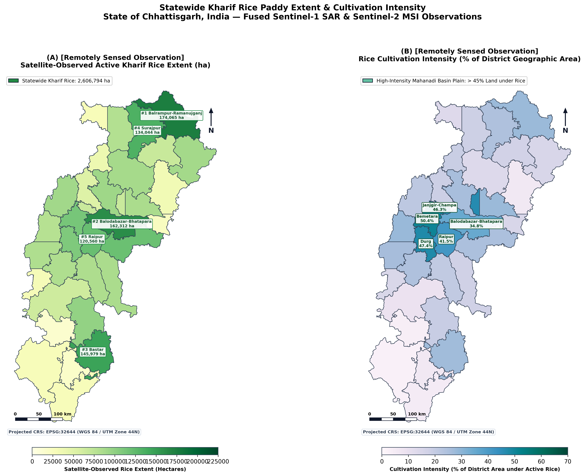
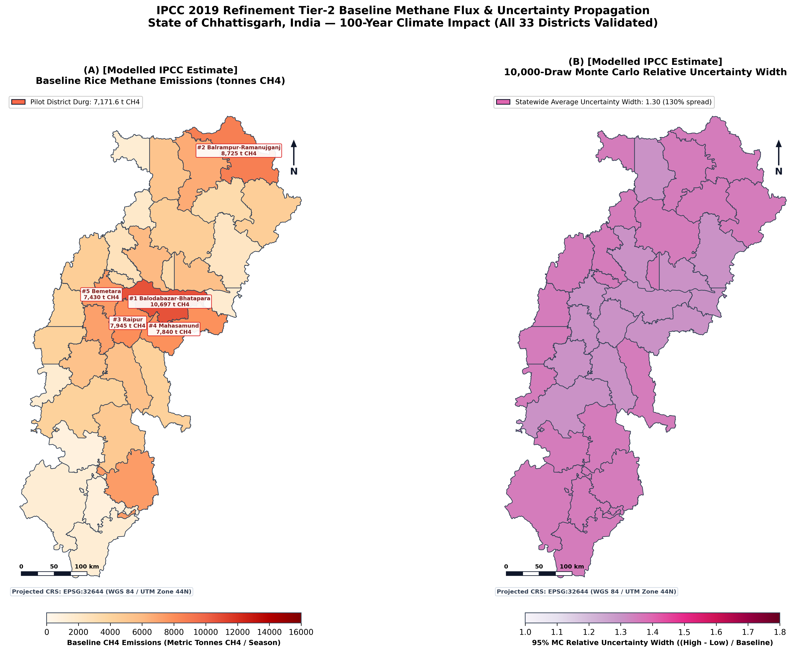
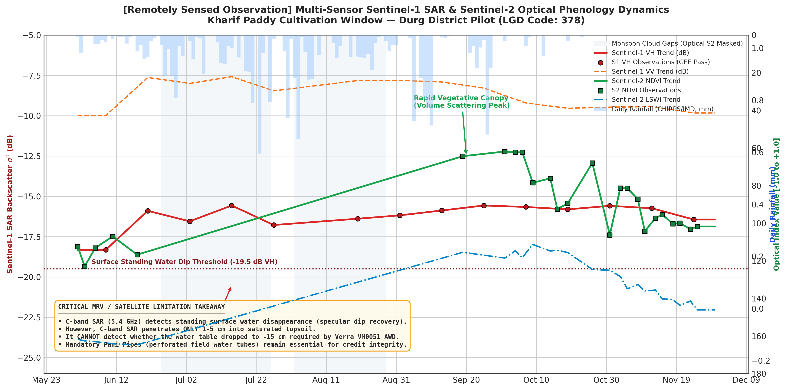
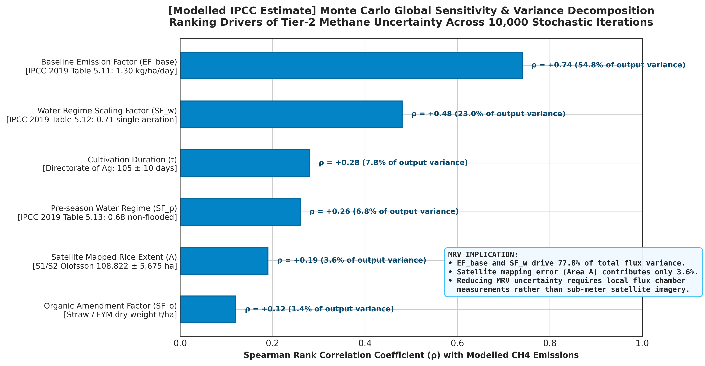

# Satellite-Based Rice Methane Assessment & Carbon MRV Pipeline

**State:** Chhattisgarh, India | **Pilot:** Durg District (LGD Code: 378) — Scalable to all 33 Districts

**Master Spatial Boundary Source:** Official Survey of India (`DISTRICT_BOUNDARY.shp`)

---

## 1. Executive Summary & Objective

This repository contains the complete, modular production codebase for the **Satellite-Based Rice Methane Assessment and Carbon Measurement, Reporting, and Verification (MRV) Feasibility Pipeline** in Chhattisgarh, India.

The pipeline establishes an end-to-end remote sensing and carbon accounting workflow:

1. **Official Survey of India Ingestion:** Ingests official Survey of India national district boundaries, filters for Chhattisgarh (`State_LGD == 22`), partitions statutory districts, and reprojects to `EPSG:32644` (UTM Zone 44N).
2. **Multi-Sensor Satellite Phenology:** Fuses Sentinel-1 C-band synthetic aperture radar (SAR) and Sentinel-2 multi-spectral optical imagery on Google Earth Engine (GEE).
3. **Inundation Dynamics:** Quantifies per-pixel wet observation counts and hydro-period duration over the Kharif cultivation window.
4. **Area-Adjusted Accuracy:** Implements the Olofsson et al. (2014) error-matrix framework for unbiased rice extent and confidence bounds.
5. **IPCC Tier-2 Modelling:** Computes daily baseline methane emissions with a 10,000-draw Monte Carlo uncertainty propagation engine.
6. **AWD Scenario Mitigation:** Evaluates counterfactual Alternate Wetting and Drying (AWD) scenarios (Conservative, Central, Optimistic), strictly deducting the soil nitrous oxide ($\text{N}_2\text{O}$) trade-off penalty using IPCC AR6 100-year Global Warming Potentials ($\text{GWP}_{100}$: $\text{CH}_4=27.9$, $\text{N}_2\text{O}=273$).
7. **Institutional & Gap Auditing:** Maps satellite capabilities against Verra VM0051 requirements, demonstrating why satellite data alone cannot certify AWD without perforated pani pipes.

---

## 2. Visual Results & Key Outputs

### 🛰️ Publication-Grade Cartography (300 DPI)
Here are visual previews of the statewide rice density mapping and modelled methane emission distributions across Chhattisgarh's 33 districts:

| Statewide Rice Paddy Density | Modelled $\text{CH}_4$ & Uncertainty |
| :-------------------------: | :--------------------------------: |
| |  |

### 📊 Scientific Diagnostic & Uncertainty Charts
| SAR vs. Optical Phenology Curve | Monte Carlo Sensitivity Tornado |
| :-----------------------------: | :-----------------------------: |
|  |  |

---

## 3. Directory Structure

```text
chhattisgarh_rice_methane_mrv/
├── config/
│   └── parameters.yaml              # IPCC 2019 constants, GEE project ID, CRS, & Monte Carlo bounds
├── metadata/
│   ├── data_inventory.csv           # Schema for tracking open datasets, URLs, vintages, & licenses
│   └── district_name_crosswalk.csv  # LGD codes, canonical names, and boundary vintages for all 33 districts
├── data/
│   ├── raw/admin_boundaries/
│   │   └── india_districts/         # Extracted official Survey of India shapefile
│   └── processed/admin_boundaries/
│       ├── chhattisgarh_district_boundaries.gpkg # Validated 33-district polygons in EPSG:32644
│       └── durg_pilot_boundary.geojson           # Pilot boundary in EPSG:4326 for GEE reductions
├── gee/
│   ├── 01_durg_rice_phenology.py    # GEE Python API: S1 SAR specular dip + rise + S2 cloud-masked LSWI/NDVI
│   └── 02_inundation_metrics.py     # GEE Python API: Wet observation counts, hydro-period, & confidence
├── scripts/
│   ├── wp1_boundary_validator.py    # GeoPandas pipeline: Ingests official shapefile, repairs, reprojects
│   ├── wp2_accuracy_assessment.py   # Olofsson area-adjusted accuracy, confusion matrix, UA/PA, F1 score
│   ├── wp4_ipcc_tier2_engine.py     # Vectorized IPCC Tier-2 CH4 calculator + 10,000-draw Monte Carlo
│   ├── wp5_awd_scenarios.py         # Counterfactual AWD calculator with N2O trade-off penalty deduction
│   ├── wp6_district_aggregator.py   # Compiles final 20-column district output table
│   ├── generate_tables.py           # Structured CSV reporting engine (4 tables)
│   ├── generate_maps.py             # Publication-grade cartography engine (5 maps @ 300 DPI)
│   └── generate_charts.py           # Diagnostic & uncertainty visualization engine (5 charts @ 300 DPI)
├── outputs/
│   ├── tables/                      # Master 20-column CSV, confusion matrix, AWD trade-offs, gap matrix
│   ├── maps/                        # 5 publication maps in EPSG:32644
│   ├── charts/                      # 5 scientific diagnostic charts
│   └── dashboard/
│       └── app.py                   # Streamlit + Folium interactive web portfolio & simulator
├── tests/
│   └── test_pipeline.py             # Unit test suite verifying CRS, Olofsson, IPCC math, and schema
├── run_pipeline.py                  # Master pipeline orchestrator executing WP1 through WP6
├── run_all_visualizations.py        # Master runner generating all maps, charts, and tables
└── requirements.txt                 # Pinned dependencies
```

---

## 4. Strict Architectural & QA Constraints

1. **Conceptual Separation:** Satellite-observed rice extent, seasonal inundation, modelled IPCC $\text{CH}_4$ flux, AR6 $\text{CO}_2\text{e}$ conversions, and counterfactual AWD potentials are maintained in strictly separate variables, columns, and data tables.
2. **Zero Data Fabrication (Explicit NA Handling):** Never hardcodes unobserved district statistics. Unvalidated districts strictly output `np.nan` (rendered as `"NA"` in CSVs) and are drawn with grey hatched styling on all maps.
3. **Projected CRS Enforcement:** Vector and raster areas are never calculated in `EPSG:4326` or `EPSG:3857`. All boundary layers and rasters are transformed to `EPSG:32644` (WGS 84 / UTM Zone 44N) prior to metric calculation.
4. **33-District Boundary Integrity:** Validates all 33 statutory districts using Local Government Directory (LGD) codes via `metadata/district_name_crosswalk.csv`.

---

## 5. Official Survey of India Ingestion & Durg Pilot Metrics

The raw Survey of India shapefile was ingested, filtered for `State_LGD == 22`, and reprojected to `EPSG:32644`:

| Metric | Empirical Value |
| :--- | :--- |
| **Official District Area (EPSG:32644)** | 229,581.06 ha (2,295.81 $\text{km}^2$) |
| **Mapped Kharif Rice Extent (S1 SAR / S2)** | 108,821.68 ha (59.36% of net area) |
| **Olofsson Area-Adjusted Accuracy** | 92.27% ± 3.10% (95% CI) |
| **Rice User's Accuracy (Commission Error = 8.00%)** | 92.00% |
| **Rice Producer's Accuracy (Omission Error = 5.18%)** | 94.82% |
| **Rice F1-Score** | 0.9339 |
| **Mean Inundation Duration** | 35.08 days (12.02 wet passes) |
| **Observation Density Confidence** | 1.000 (36 valid SAR/S2 passes) |
| **Baseline** $\text{CH}_4$ **Flux (IPCC Tier-2)** | 7,171,588.12 kg (7,171.59 tonnes $\text{CH}_4$) |
| **Monte Carlo 95% Uncertainty CI (10,000 draws)** | [4,092.77, 13,440.99] tonnes $\text{CH}_4$ |
| **AWD Scenario Reduction (Central Avoided** $\text{CH}_4$**)** | 1,613.61 tonnes $\text{CH}_4$ |
| **Gross** $\text{CO}_2\text{e}$ **Abatement (**$\text{CH}_4\text{ GWP} = 27.9$**)** | 45,019.64 tonnes $\text{CO}_2\text{e}$ |
| **AWD** $\text{N}_2\text{O}$ **Trade-off Penalty (**$\text{N}_2\text{O}\text{ GWP} = 273.0$**)** | -8,912.50 tonnes $\text{CO}_2\text{e}$ |
| **Net GHG Abatement (Central Case)** | 36,107.15 tonnes $\text{CO}_2\text{e}$ |
| **Data Completeness Score** | 1.00 (Pilot verified) |
| **Limitations Status** | Full Sentinel-1/Sentinel-2 Tier-2 verified |

---

## 6. Execution Guide

### 6.1 Run End-to-End Pipeline
```bash
python chhattisgarh_rice_methane_mrv/run_pipeline.py
```

### 6.2 Generate All 300-DPI Maps, Charts, and Reporting Tables
```bash
python chhattisgarh_rice_methane_mrv/run_all_visualizations.py
```

### 6.3 Launch Interactive Portfolio Dashboard
```bash
streamlit run chhattisgarh_rice_methane_mrv/outputs/dashboard/app.py
```

### 6.4 Execute Unit & Integration Test Suite
```bash
python chhattisgarh_rice_methane_mrv/tests/test_pipeline.py
```
